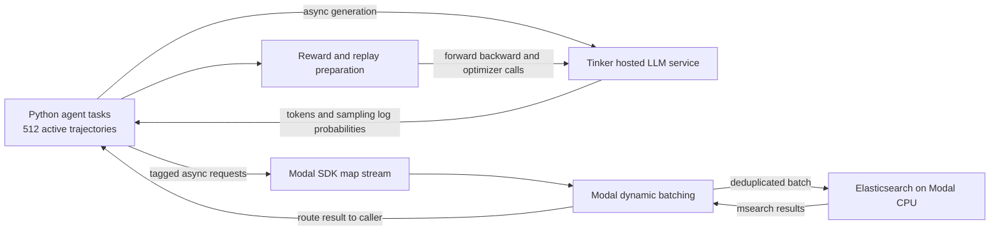

# ReAct RAG RL

**Can reinforcement learning improve a multi-turn RAG agent's tool use?** This project fine-tunes **Qwen3.5-4B** to reason, search, and answer multi-hop questions. It compares final-answer-only supervision with local process-aware advantage shaping: reinforce acquiring reference evidence, discourage searches returning nothing new, and penalize malformed actions.

The engineering component is a distributed Python application coordinating **Tinker** for hosted generation/training and **Modal-hosted Elasticsearch** for retrieval over **5.2 million Wikipedia abstracts**. Tinker owns GPU scheduling and optimization. This repository owns the agent loop, reward/advantage construction, retrieval integration, replay preparation, persistence, and evaluation.

## Full validation results

Each policy completed **7,405 HotpotQA development questions × five independently seeded attempts = 37,025 trajectories**. Mean accuracy includes every attempt, including budget-exhausted trajectories; there were zero infrastructure errors. Pass@5 is oracle any-correct, not a deployed answer-selection procedure.

| Metric | Non-fine-tuned base | EM-only | Local 0.33 | Local 0.67 |
|---|---:|---:|---:|---:|
| Mean normalized exact match | 38.71% | 46.01% | **46.75%** | 46.71% |
| Mean token F1 | 49.42% | 57.75% | 59.08% | **59.25%** |
| Oracle pass@5 | 58.06% | 60.68% | **60.88%** | 60.59% |
| Generated tokens per trajectory | 912.07 | 624.92 | 510.27 | **440.13** |
| Searches per trajectory | 3.18 | 3.18 | 3.02 | **2.95** |
| Generated turns per trajectory | 4.89 | 4.31 | 4.06 | **3.97** |
| Accepted final answer | 73.09% | 85.10% | 90.36% | **91.67%** |
| Searches returning no new documents | 21.05% | 19.17% | 14.29% | **12.70%** |
| Protocol-invalid turns | 17.21% | 3.69% | 1.21% | **0.59%** |
| Full gold-document coverage | 31.03% | 35.57% | 36.16% | **36.50%** |


### Findings

- EM-only training added **7.30 percentage points** of accuracy over the base agent. Search counts barely changed, but generation became shorter and protocol errors fell.
- Local 0.33 added **0.74 points** over EM-only, 95% paired interval **[+0.34, +1.15]**. Local 0.67 added **0.70 points**, interval **[+0.31, +1.09]**.
- Against EM-only, local 0.67 used **29.6% fewer generated tokens**. Against the base agent it used **7.4% fewer searches**, **18.9% fewer turns**, and **51.7% fewer output tokens**.
- The accuracy difference between 0.67 and 0.33 was **−0.04 points**, interval **[−0.41, +0.33]**. Their accuracy was not clearly different; stronger shaping's clearest benefit was efficiency.
- Pass@5 stayed near 61% across trained policies. This is consistent with improved reliability per attempt rather than a large expansion in questions solved at least once; it does not establish the causal mechanism.

Intervals use **10,000 paired percentile bootstrap resamples of whole questions**, seed 42. Each question's five attempts stay together; both policies use the same resample. Search/turn rates recompute their numerators and denominators per resample. These exploratory intervals are not multiplicity-adjusted and measure **question variation, not training-seed variation**.


## Motivation and agent behavior

A correct final answer can hide redundant searches or malformed calls. Conversely, an incorrect answer can follow useful evidence acquisition. Outcome-only supervision gives limited explicit feedback about those intermediate behaviors. The experiment tests whether deterministic process signals improve the learned agent's effectiveness and efficiency. It is a comparison of training recipes, not a claim of a new RL algorithm or proven causal credit assignment.

The ReAct-style agent emits `<reasoning>...</reasoning>` followed by one `<search>query</search>` or `<answer>short answer</answer>`. Retrieval returns an `<information>` block. The prompt requires at least one search, reserves action tags for actual actions, and treats retrieved text as evidence rather than instructions. Generation stops at the closing action tag. Earlier reasoning, actions, and evidence remain in context; context overflow is explicit rather than silently evicting evidence.

## Data and retrieval

**HotpotQA fullwiki** provides 90,447 labeled training questions and 7,405 labeled development questions. Official hidden-test inputs are kept separate and are not scored. The retrieval corpus contains **5,233,329 introductory paragraphs** from the official October 2017 Wikipedia abstracts archive. Retrieval uses our Elasticsearch BM25 implementation, not the original benchmark retrieval system.

Each abstract is one retrievable document with a `document_id`; there is no custom overlapping chunking. Reference titles map to gold document IDs for retrospective scoring. Answers, gold evidence, and question difficulty do not enter policy prompts. Sentence annotations remain diagnostic metadata: process rewards measure document acquisition, not supporting-sentence precision.

Training uses a seeded, interleaved 50/50 hard–medium schedule from the official training split, excluding easy questions. Each 512-question pool contains 256 hard and 256 medium questions. Arms use the same question order. Fifteen pools cover 7,680 distinct training questions per main run.

## Training methodology

### Outcome-only baseline

For trajectory i in sibling group q, normalized exact match gives reward O:

$$
O_i=\mathbf{1}[\text{accepted final answer matches a reference}],\qquad
A_i^{\mathrm{out}}=O_i-\frac{1}{G_q}\sum_{j\in q}O_j.
$$

Answer normalization removes case, punctuation, articles, and excess whitespace. Wrong and unfinished trajectories receive zero reward. Technical failures are not silently scored as wrong answers. The baseline broadcasts the centered coefficient to generated tokens. There is **no standard-deviation normalization or RMS scaling**.

### Local process advantage shaping

For generated turn t, define:

- **g = 1:** a successful search acquires at least one previously unseen gold document. Multiple new gold documents in one turn still earn one bonus.
- **Q = 1:** a successful search returns no new document IDs, OR a search is initiated after all gold IDs have been collected. This is one OR penalty. “No new” concerns **all documents**, not just gold evidence. Successful empty results count; transport failures do not.
- **I = 1:** the generated turn violates the action protocol, for example malformed, empty, nested, or multiple actions.
- **M:** a token mask selecting the identifiable malformed action span. Missing action markup or ambiguous token alignment falls back to the whole generated turn.

The task coefficient for token u is

$$
A_{i,t,u}^{\mathrm{local}}=A_i^{\mathrm{out}}+w_g g_{i,t}-w_q Q_{i,t}-w_p I_{i,t}M_{i,t,u}.
$$

All three weights equal **0.33** or **0.67** in the two local arms. Acquisition and search-quality adjustments apply to the entire generated turn, including reasoning. Protocol penalties target malformed action spans when identifiable. Valid answer turns retain outcome credit. Process terms are not centered, discounted, or propagated backward. These surrogate coefficients can change sign; they are not claimed to be unbiased Q-minus-V estimates.

### Optimization and replay

| Setting | Value |
|---|---|
| Model / adaptation | Qwen/Qwen3.5-4B / LoRA rank 32 |
| Optimizer / learning rate | AdamW / 1e-5, no warm-up |
| Rollout pool | 512 questions × 5 siblings = 2,560 trajectories |
| Optimizer minibatches | Two 256-question minibatches, one pass, one step each |
| Main run | 15 pools, 30 updates, 38,400 trajectories |
| Sampling | Temperature 1.0, top-p 1.0, master seed 42 |
| Agent limits | 8 generated turns, 7 searches, top-K 2 |
| Token limits | 512 new tokens per turn; 8,192 context tokens |
| PPO clip / gradient clip | 0.2 both sides / norm 1.0 |
| Reference KL coefficient | 0.01 |
| Active trajectory limit | 512 |
| Checkpoints | Initial, every five updates, final |

Each arm starts a new adapter from the base model. Exact sampled completion IDs and old sampling log probabilities are retained for replay. Each turn becomes one Tinker datum containing its full preceding context. Prompt and tool targets have zero direct policy-loss coefficient but still condition predictions. Sampled assistant history is not re-rendered/re-tokenized; only new observations and delimiters are encoded.

Tinker calculates current-policy probabilities and executes clipped importance-weighted updates. Token coefficients are divided by the original minibatch sampled-token denominator, retained when groups are filtered. Tinker handles internal GPU microbatching. This is GRPO-style grouping/centering with a hosted PPO loss, **not an exact Search-R1 or DAPO reproduction**.

Groups with all-zero task coefficients are omitted without replacement. EM-only drops tied-outcome groups; local shaping can retain those groups when a local coefficient is nonzero. Eligibility is fixed before reference scoring. For surviving completion tokens, the frozen-base adjustment is

$$
k_u=\log\pi_{\mathrm{rollout}}(y_u\mid x_u)-\log\pi_{\mathrm{base}}(y_u\mid x_u),
\qquad A'_u=A_u+0.01(\bar{k}-k_u).
$$

The mean is over surviving completion tokens in the pool. This is a sampled log-ratio adjustment, not exact vocabulary-summed KL. Prepared rollouts and reference scores stay in memory across minibatches. Sampling weights refresh before collecting a new pool. In-training validation is disabled; final checkpoint selection is fixed in advance.


## Distributed system design



One agent's reasoning/search loop is sequential; independent agents overlap network waits. The active limit covers **whole trajectories**, not single searches. Tinker schedules GPU work. Modal supplies remote communication and dynamic batch formation, avoiding a custom client-side batching timer/worker pool. A lightweight queue feeds one native `map.aio` stream; request IDs route results back to waiting tasks.

Elasticsearch runs on **4 requested CPU cores, 16 GiB memory, and a 4 GiB heap**. Modal assembles query batches; `_msearch` submits those batches, and Elasticsearch schedules their searches. Code defaults are a maximum dynamic batch of 512 and a 10 ms collection window, configurable at deployment. Diagnostic runs varied batching settings; these defaults are not universal optima.

Identical full request payloads are deduplicated within a server batch. `_msearch` uses 16 concurrent searches, disables unnecessary exact total-hit counting, and opts into Elasticsearch shard request caching. Returned results are mapped back to all original callers. Cache hits remain search actions; Elasticsearch owns eviction/invalidation, and cache warmth is lost on container restart.

### Performance investigation

Client search latency was sometimes tens of seconds despite much shorter Elasticsearch execution. Instrumentation measured SDK handoff, function entry, downstream processing, and result return where observable. The SDK reached an effective 1,000-outstanding-input limit, and substantial waiting occurred before function entry. Increasing Elasticsearch resources did not reliably resolve latency.

Bounding active trajectories reduced accumulated work:

| Live workload: 2,560 trajectories | Completion time | Trajectories/s |
|---|---:|---:|
| 2,560 active | 243.54 s | 10.51 |
| 512 active, repeat 1 | 151.86 s | 16.86 |
| 512 active, repeat 2 | 158.39 s | 16.16 |

The bounded runs averaged **approximately 36% shorter completion time**. These are live measurements with stochastic outputs and variable hosted-service conditions, not a guaranteed or randomized causal speedup. We localized concurrency-dependent congestion beyond Elasticsearch, but did **not** prove a specific Modal policy or SDK defect caused every second of delay.

Separately, tuning Elasticsearch reduced time for the same **2,560 saved queries from 158.19 s to 23.53 s (6.7×)**, with identical top-K IDs/order. This direct-service benchmark excludes LLM generation. Disabling exact hit counting and increasing concurrent searches were important changes. The direct-service and end-to-end speedups must not be multiplied together.

A local saved-output replay tested event-loop overhead: waits alone took 67.8 s versus 68.3 s with real CPU processing. Simulated search timers resumed median 9 ms and p95 61 ms late. This did not reproduce Modal internals, but local processing could not explain tens of seconds of remote waiting in that workload. CPU-capacity comparisons also differed in cache/container state and were inconclusive.

Each main run generated approximately **170K–177K LLM calls and 122K–126K logical search requests**. Logical requests are not physical HTTP calls because of batching/deduplication.

### Reliability and persistence

- Final presets use one trajectory attempt and no application search retries. Elasticsearch transport retries and Modal batch-function retries are disabled; provider SDK internal network behavior is service-owned.
- Wrong answers and budget exhaustion are scored outcomes, not retried until success. Malformed actions can receive corrective feedback within the remaining turn budget.
- Search stream failures explicitly fail unresolved callers; a shared transport failure can affect multiple trajectories. Result IDs prevent silent response reassignment. Partial training groups require at least two usable siblings.
- Evaluation saves each raw trajectory immediately with atomic replacement and bounded retries for transient Windows file-sharing conflicts. Reruns reuse valid saved attempts. Aggregate exports occur at completion.
- Training retains rollout arrays in RAM and saves compact statistics. Full model/optimizer state lives in Tinker. Local progress advances after successful checkpoints; a single-writer lock protects each run.
- Resume restores the last checkpoint and starts a fresh pool. Uncheckpointed updates and unused in-memory rollouts can be lost. This is not an exactly-once training system.
- Modal Volumes retain the corpus and index snapshots. New containers restore snapshots to local disk instead of re-indexing 5.2M documents. Live index files are not shared between processes. The CPU service can scale to zero.

## Reproduce

Requires Python 3.11, [uv](https://docs.astral.sh/uv/), Tinker credentials/credit, and Modal authentication. No local CUDA or PyTorch installation is needed for the hosted path. **Training/evaluation incur model charges; indexing/deployment incur CPU/storage charges.**

```powershell
git clone https://github.com/PavanRajGowda/react-rag-rl.git
cd react-rag-rl
uv sync --frozen
uv sync --project tinker_training --frozen
uv run modal setup
# Configure TINKER_API_KEY privately; never commit a real key.
```

Download the official HotpotQA Wikipedia **abstracts** archive. Preparation verifies its checksum, loads pinned Hugging Face question splits, and streams the corpus. The full-article archive is not used here.

```powershell
uv run --frozen python -m retrieval_service.hotpotqa --archive "PATH/TO/enwiki-20171001-pages-meta-current-withlinks-abstracts.tar.bz2"
uv run --frozen modal run modal_app.py --upload
uv run --frozen modal run modal_app.py --build-index
uv run --frozen modal deploy modal_app.py
uv run --frozen modal run modal_app.py --verify-deployed
```

Existing service/volume names retain their `hotpotqa` dataset identity so renaming this repository does not orphan deployed indexes.

```powershell
# Local preflight; does not launch a paid training run
uv run --project tinker_training --frozen python -m tinker_training preflight --config tinker_training/configs/em-30.json

# Paid training: fresh directory per arm
uv run --project tinker_training --frozen python -m tinker_training train --config tinker_training/configs/em-30.json --run-dir data/tinker/em
uv run --project tinker_training --frozen python -m tinker_training train --config tinker_training/configs/process-local-30.json --run-dir data/tinker/local033
uv run --project tinker_training --frozen python -m tinker_training train --config tinker_training/configs/process-local-w067-30.json --run-dir data/tinker/local067

# Paid base evaluation, all development questions
uv run --project tinker_training --frozen python -m tinker_training baseline --config tinker_training/configs/inference-batch-diagnostic.json --run-dir data/tinker/eval-base --start 0 --count 7405 --repetitions 5 --batch-size 512 --stream-attempts 1

# Paid trained evaluation, using your own checkpoint pointer
$state = Get-Content data/tinker/local067/progress.json | ConvertFrom-Json
uv run --project tinker_training --frozen python -m tinker_training baseline --config tinker_training/configs/inference-batch-diagnostic.json --run-dir data/tinker/eval-local067 --checkpoint $state.checkpoint --start 0 --count 7405 --repetitions 5 --batch-size 512 --stream-attempts 1

# CPU tests; no paid hosted calls
uv run --frozen python -m pytest -q
# Offline training plots
uv run --no-project --with matplotlib --with numpy python -m experiments.plot_training_curves data/tinker/em
# Offline paired evaluation analysis; reads your saved raw trajectories
uv run --no-project --with numpy python -m experiments.compare_evaluations --before data/tinker/eval-base --after data/tinker/eval-local067 --output data/analysis/local067-vs-base.json
```

Match question IDs, repetition seeds, prompts, budgets, and retrieval settings across evaluations. Without an explicit checkpoint, evaluation samples the base model. Private checkpoint paths, account IDs, raw traces, datasets, and credentials are not distributed here.

## Code map

| Path | Responsibility |
|---|---|
| `baseline_agent/` | Shared controller, prompt, protocol, grading and evaluation persistence |
| `batched_inference/` | Async execution and exact append-only token conversations |
| `tinker_training/` | Hosted sampling, sibling groups, local credit, KL, replay packing and optimizer/checkpoint loop |
| `retrieval_service/`, `modal_app.py` | HotpotQA preparation, dynamic batching and persistent Elasticsearch |
| `experiments/` | Offline evaluation analysis and training plots |
| `tests/` | CPU tests using fake hosted clients |
| `reports/` | Result graphs only; methodology/findings live in this README |

## Limitations

One training seed per arm and 30 updates make this a short fine-tuning study. Local shaping changes coefficient magnitude and group retention as well as feedback location; results do not isolate temporal allocation. Gold-document signals are privileged supervision and imperfect usefulness proxies. No-new IDs do not prove semantic redundancy; coverage does not prove evidence use.

The development set is the evaluation benchmark. No official hidden-test result, independent training-seed replication, or acquisition-only/penalties-only ablation is claimed. A historical broadcast pilot used a different reward formulation and is not a matched allocation control.

Raw paid runs remain local under ignored `data/`. Public figures summarize them; exact stochastic outputs, prices, and timing need not reproduce. No publication or algorithmic novelty is claimed.

## References

- [HotpotQA and official corpus](https://hotpotqa.github.io/)
- [ReAct](https://arxiv.org/abs/2210.03629)
- [DeepSeekMath / GRPO](https://arxiv.org/abs/2402.03300)
- [Search-R1](https://github.com/PeterGriffinJin/Search-R1)
- [Tinker documentation](https://tinker-docs.thinkingmachines.ai/)
- [Modal dynamic batching](https://modal.com/docs/guide/dynamic-batching)

Wikipedia source material retains its license, including the official archive's CC BY-SA 4.0 terms. Corpus/dataset files are not redistributed. No code license is added without the author's choice.
