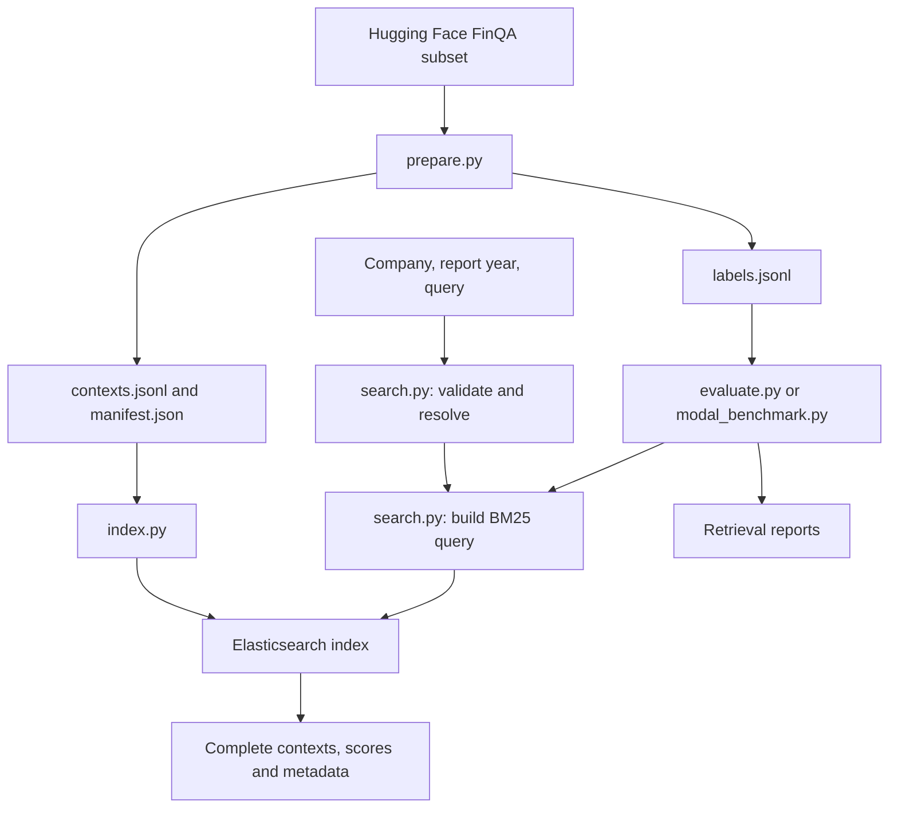

# FinanceRAG technical documentation

This is the single technical reference for the repository. It explains the
existing implementation, its files, how they connect, and what remains to be
built. The root [README](../README.md) contains commands for operating it.

## 1. What the project currently does

FinanceRAG prepares the **FinQA subset** of `G4KMU/t2-ragbench` and exposes
Elasticsearch BM25 search over its supplied financial-report contexts. A
request supplies a company name or ticker, a report year, and a text query.
Results contain complete source contexts and their metadata.

There are **2,789 unique contexts**, **799 company/year report identifiers**,
and **8,281 question rows** in the audited dataset revision. The supplied
contexts are extracted text-and-table units, not complete 10-K filings.
We do not split them into smaller chunks. Questions and answers are kept
outside the retrieval index.

The repository now contains a one-question Qwen inference baseline in
`baseline_agent/`. It does not yet contain the GPU rollout scheduler,
reinforcement-learning trainer, rewards, or training checkpoints.

## 2. Execution modes

| Mode | Entry point | Purpose | Elasticsearch location |
|---|---|---|---|
| Private Modal search | `modal_app.py` | Intended tool for future GPU rollouts | Inside each CPU search container |
| HTTP API | `finance_rag/api.py`, optionally `modal_external.py` | Local development or an external persistent Elasticsearch service | Local Docker, a VM, or Elastic Cloud |
| Kibana explorer | `modal_kibana.py` | Browse contexts in Discover and experiment in Dev Tools | A separate secured copy inside the dashboard container |
| Baseline inference | `baseline_agent/modal_app.py` | One FinQA test question on a T4, with multi-turn generation/search | Calls the independently deployed private search service |

Kibana does not inspect the live cluster in a training search container.
Its copy is built from the same corpus and hash, so it is useful for reviewing
data and mappings without competing with training traffic.

## 3. Data and request flow



Preparation happens before deployment. Runtime indexing happens once per
cold search-container startup. A warm container handles many searches using
the same process, client connection pool, registry, and immutable index.

### Corpus preparation

1. Resolve a requested Hugging Face revision to its commit SHA and load only
   the `FinQA` configuration.
2. Copy the supplied text and Markdown table without changing their content.
   Convert report year and page number to integers and normalize ticker case.
3. Use CIK as company identity when available, with a ticker fallback. Combine
   company identity and report year to construct a report identifier.
4. Deduplicate by `context_id`. Conflicting content or metadata for the same
   ID causes an error rather than silently picking one row.
5. Write corpus and QA labels to separate files. Calculate a deterministic
   corpus hash, dataset counts, and split-overlap statistics.

The audited revision is `adf7fe1541ac37351ce1142544d8e3b43010ed92` and the
corpus version is `finqa-301676584646`. The current index name appends the search
schema: `finqa-301676584646-search-v4`. The CLI's default revision is
`main`; pass the audited SHA to reproduce these exact artifacts.

### Search handling

1. `SearchRequest` validates company/ticker, year and query; top_k defaults to 2.
2. `retrieval.py` resolves issuer names or exact tickers in Elasticsearch and
   aggregates all candidates and their report years with composite pagination.
3. Ambiguous names return candidates; unavailable report years for known issuers
   return an error with available years. Neither triggers a broad fallback.
4. If an issuer name has no match, search indexed text/table with name plus query,
   without issuer/year filters, and explicitly explain this relaxation.
5. Return full contexts ranked by score then context ID. Empty results and
   infrastructure errors remain distinct. No document text is scanned in Python
   during requests, and no synonym extraction or lookup is performed.

Year means report year, rather than a financial period inside a table.

## 4. File-by-file map

### Environment, configuration, and entry points

| File | What it does | How it relates to other files |
|---|---|---|
| `README.md` | Operating commands, examples, current verification results, and limitations | Links to this document; explains how to run the entry points below |
| `technical documentation/README.md` | This single architecture and file reference | Gives the reading order and dependency map for reviewing the implementation |
| `pyproject.toml` | Python 3.11 requirement, application dependencies, dev tools, and pytest path configuration | Source configuration used by `uv` to resolve `uv.lock` |
| `.python-version` | Pins the local Python minor version to 3.11 | Read by `uv`; Modal images also request Python 3.11 |
| `uv.lock` | Exact dependency resolution, including transitive packages and hashes | Used by `uv sync --frozen`; do not edit manually |
| `requirements.lock.txt` | Export of runtime dependencies from `uv.lock`, with hashes and platform markers | Used by Modal image builders; regenerate with `uv export` after dependency changes |
| `.gitignore` | Excludes virtual environments, downloaded tools, raw/generated data, credentials, and caches | Keeps `data/kibana-credentials.json`, `.env`, and local setup artifacts out of commits |
| `.env.example` | Placeholder configuration for the external HTTP/indexing mode | Documents `ELASTICSEARCH_URL`, `ELASTIC_API_KEY`, `SEARCH_API_TOKEN`, `FINQA_DATA_DIR`, and `ES_REPLICAS`; `.env` is not loaded automatically |
| `compose.yaml` | Starts local single-node Elasticsearch 8.19.3 with a named data volume | Supports `index.py`, `api.py`, and `evaluate.py`; binds its unauthenticated port to localhost and is for local development |
| `modal_app.py` | Private `finance-rag-search` deployment, lifecycle hooks, smoke test, and Modal-to-Modal connectivity check | Wraps `EmbeddedSearch`; optionally invokes `modal_benchmark.py`; bundles corpus and manifest but not QA labels |
| `modal_external.py` | Alternative `finance-rag-search-http` deployment | Wraps `api.create_app()` and uses the `finance-search` Modal secret to connect to externally hosted Elasticsearch |
| `modal_kibana.py` | Optional `finance-rag-kibana` browser deployment and resource limits | Builds `docker/Kibana.Dockerfile`, injects generated credentials as a Modal secret, and wraps `KibanaStack` |
| `docker/Kibana.Dockerfile` | Combines matching Elasticsearch and Kibana 8.19.3 distributions | Builds only from the `docker` context; Python and locked dependencies are added by `modal_kibana.py` |

### Python package

| File | Main responsibility | Dependencies and callers |
|---|---|---|
| `finance_rag/__init__.py` | Empty package marker | Allows modules to be imported and run with `python -m finance_rag.<module>` |
| `finance_rag/prepare.py` | Dataset download, deduplication, separate exports, content hashing, and audit | Uses Hugging Face libraries; its outputs feed all runtime modes and evaluation |
| `finance_rag/search.py` | `SearchRequest`, `SearchError`, company `Registry`, corpus loading, and query construction | Shared by the HTTP API, embedded service, indexer, and evaluator; does not start Elasticsearch |
| `finance_rag/index.py` | Client configuration and `index_corpus()` | Loads corpus through `search.py`, builds strict mappings, bulk indexes, checks count, and write-blocks the corpus index; can use an injected authenticated client |
| `finance_rag/api.py` | FastAPI `/v1/search` and `/health` with bearer authentication | Uses `search.py` and `AsyncElasticsearch`; validates local hash, remote manifest hash, and remote count at startup |
| `finance_rag/embedded.py` | Elasticsearch subprocess lifecycle and private search implementation | Used by Modal search and Kibana; uses `index_corpus()` and shared request/query code; optionally enables loopback basic authentication for Kibana |
| `finance_rag/evaluate.py` | Sequential retrieval evaluation against an external Elasticsearch endpoint | Uses QA labels locally plus `Registry`/`query_body()`; records Recall@5/10, MRR@10, ranks, and exclusions |
| `finance_rag/modal_benchmark.py` | Asynchronous retrieval evaluation through Modal | Called by `modal_app.py --evaluate`; limits outstanding calls to eight, keeps labels on the caller, and records request latency and retrieval metrics |
| `finance_rag/kibana_setup.py` | Generates random passwords and encryption keys without printing their values | Creates ignored local credential and login files read by the dashboard deployment/verifier |
| `finance_rag/kibana.py` | Starts secured Elasticsearch, creates roles/users, starts Kibana, and seeds the default data view | Uses `EmbeddedSearch`; keeps admin/system passwords out of the browser login and restricts the researcher to reading corpus documents |
| `finance_rag/kibana_verify.py` | End-to-end verification of the deployed browser service | Reads local credentials, checks unauthenticated rejection and cookie login, queries via Kibana Console, then compares every returned source against the corpus hash |

`index_corpus()` owns and closes a client it creates itself. When Kibana or
the embedded service supplies a client, the caller retains ownership and
closes it during shutdown. This allows indexing and later authenticated
operations to reuse the same connection pool.

### Tests

The existing tests are organized by component so they can accompany the
corresponding commits. This organization preserves their test logic.

| File | What it checks |
|---|---|
| `tests/__init__.py` | Package marker for consistent shared-helper imports |
| `tests/helpers.py` | Synthetic context with a table, parentheses/signs, units, and a footnote; used by component tests |
| `tests/test_prepare.py` | Exact text/table preservation, QA-label separation, deduplication, split overlap, byte-level checksum, and conflicting-context rejection |
| `tests/test_search.py` | Required fields and bounds, company resolution, metadata filters, HTTP authentication, complete responses, legitimate empty results, and backend failure status |
| `tests/test_company_matching.py` | Analyzed query construction, distinct-company ambiguity, candidate metadata, ticker refinement, both API error formats, and partial-candidate failure handling |
| `tests/test_index.py` | Indexing retains ownership of an injected authenticated client and supplies the intended source documents to bulk indexing |
| `tests/test_embedded.py` | Private Modal argument errors and rejection of partial Elasticsearch responses |
| `tests/test_kibana.py` | Remote module import succeeds without reading developer-machine credential files |

The full suite collects 57 test cases with observability dependencies, including five parameterized validation
cases and seven baseline-controller tests documented in section 9. Most tests
inject a fake client; they do not start Java, Docker,
Kibana, or a GPU. Saved reports below provide evidence of previous live runs.

### Saved verification reports

| File | Evidence recorded | Interpretation |
|---|---|---|
| `reports/finqa-manifest.json` | Audited source revision, corpus hash/counts, lengths, blank question ID, and split overlap | Snapshot copied from the generated manifest; no raw corpus or answers are committed here |
| `reports/modal-smoke.json` | First-call duration, source preservation, metadata filters, and argument-error checks | A previous real Elasticsearch run in Modal; not a general availability guarantee |
| `reports/modal-retrieval-dev.json` | Metrics and per-question ranks/latencies for 883 development questions | Gold company/year filters and question-as-query; measures retrieval, not model tool selection or answer correctness |
| `reports/modal-deployed.json` | A second Modal container successfully calls the deployed search class | Confirms the same connection pattern intended for a future GPU caller; no GPU was used |
| `reports/kibana-verification.json` | Count, cookie login, unauthenticated 401, data view, and exact corpus-hash match | Confirms every indexed context matched the prepared corpus in the verified dashboard instance |
| `reports/company-resolution-smoke.json` | Real Elasticsearch resolves `apple`, reports all matching American companies, and accepts a refined name/ticker | Verifies the analyzed company mapping and ambiguity feedback under search schema v2 |
| `reports/baseline-smoke.json` | First test question, pinned model/config, five tool attempts, six generations, and ungraded answer | Operational T4 test after debugging this same example; does not measure accuracy or evaluate the test split |
| `reports/baseline-first-five.csv` | First five test gold/predicted answers, scores, statuses and inference timings | Actual small evaluated batch, with failures preserved |
| `reports/baseline-first-five.json` | Batch score, aggregate inference time, model/dataset provenance and telemetry-resume note | 1/5 Number Match; not full-test accuracy |

Reports are historical artifacts. Starting a new deployment or changing
configuration requires fresh verification; an old report does not check a
currently running instance.

### Generated local files excluded from Git

| File or directory | Purpose |
|---|---|
| `data/finqa/contexts.jsonl` | One complete source document per unique context ID; used for indexing and company registry construction |
| `data/finqa/labels.jsonl` | Question/answer rows, split membership, and support IDs; used only by evaluation and future training |
| `data/finqa/manifest.json` | Runtime corpus version, hash, counts, and audit metadata |
| `data/retrieval-baseline.json` | Default output from the external-endpoint evaluator |
| `data/kibana-credentials.json` | Local generated researcher/system/admin passwords and encryption keys; injected into Modal as a secret |
| `data/kibana-login.txt` | Only the browser username and password for the user to open locally |
| `data/review/` | Temporary local scripts and detailed Git-message files used to organize this review; not part of the application |
| `.env` | Optional private configuration file; programs read process environment variables and do not automatically load this file |
| `.venv/` | Local Python environment created by `uv` |
| `.tools/` and `uv-download.zip` | Repository-local uv executable and its downloaded archive |
| Python, pytest, and Ruff caches | Generated tool state; unnecessary for reproducing the source |

## 5. Index schema and integrity

| Fields | Mapping | Why |
|---|---|---|
| Company/report/context identifiers, ticker, CIK, and source path | `keyword` | Exact filtering, stable identifiers, stored source metadata |
| `company_name` | `text` with standard analyzer and a `keyword` subfield | Analyzed company-name resolution; use `company_name.keyword` for exact matching/aggregations |
| `report_year`, `page_number` | `integer` | Numeric metadata with explicit conversion during preparation |
| `text`, `table_markdown` | `text` | BM25 retrieval over narrative and tabular content |
| `pre_text`, `post_text` | `text` with indexing disabled | Preserve separately in `_source`; their narrative is already represented in the full context |

Mappings are strict: unexpected fields are rejected. The manifest is stored
in mapping `_meta`, alongside `search_schema_version: 4`. The index name comes from a hash of contexts sorted by
ID, serialized with sorted JSON keys and UTF-8/LF bytes, plus a schema suffix.
The corpus hash is unchanged by this mapping update. Old indexes must be
rebuilt under the new name; the HTTP API rejects incompatible schemas.
The HTTP API and
embedded service check local integrity before serving; indexing checks the
document count and blocks later writes. The HTTP API additionally checks
remote metadata/count. The Kibana verifier reconstructs the complete corpus
from all indexed sources and compares its hash, providing a stronger check
than document count alone.

These checks establish preservation of the supplied dataset contexts. They
do not verify extraction quality against every original PDF.

## 6. Runtime lifecycle, authentication, and errors

| Mode | Current resource settings | Authentication |
|---|---|---|
| Private Modal search | 2 CPUs, 4 GB RAM, 16 concurrent inputs, at most one container, zero warm minimum, 300-second idle window | Modal caller credentials; Elasticsearch listens on container loopback |
| External HTTP wrapper | 1 CPU, 1 GB RAM, 32 concurrent inputs, at most four containers, one warm minimum | Bearer token for API calls and an Elasticsearch API key for the backend |
| Kibana explorer | 2 CPUs, 6 GB RAM, 32 concurrent inputs, at most one container, zero warm minimum, 60-second idle window | Native Kibana login; secured loopback Elasticsearch; secure browser cookies over Modal HTTPS |

`EmbeddedSearch` verifies the corpus, starts Java under UID/GID 1000, waits
for Elasticsearch readiness, and builds the index. The Java attach listener
starts eagerly using `-XX:+StartAttachListener` to accommodate Modal's gVisor
runtime. Elasticsearch entitlement protections remain enabled. During
shutdown, it closes the client, stops the subprocess, and cleans temporary
files. Its subprocess code is intended for Linux containers, not direct
execution on Windows.

`SearchService.search()` uses `asyncio.to_thread()` around the synchronous
Elasticsearch operation so a call does not block the async event loop.
This permits multiple independent calls; it does not supply a GPU rollout
scheduler or guarantee any particular sustained throughput.

The private method returns `status: ok` for valid searches, including zero
matches. Invalid arguments/company resolution return `status: error` plus
an error code. Infrastructure exceptions propagate, including rejection of
timed-out or failed-shard responses. The HTTP wrapper expresses analogous
outcomes through HTTP 200, validation/company errors, 401 for unauthorized
requests, and 503 for search infrastructure failures.

Kibana startup additionally establishes passwords, creates the researcher
role, starts Node.js, waits for readiness, and creates the **FinQA contexts**
data view without a time field. Therefore no time window hides older report
years. Corpus access is read-only; the researcher can manage Kibana views.
The outer Modal web URL is public, but Kibana protects its data APIs with
native authentication. Requests can still wake a deployed container.

Both embedded modes rebuild their local indexes after a cold start. Kibana
custom saved objects are currently ephemeral. An open browser tab can send
background requests and keep Kibana active. Use `modal app stop --yes` for
a complete stop; deployment is required to make a stopped app available again.
No deployment is started by importing this document or running unit tests.

## 7. Research interpretation and unfinished design work

The audited corpus has no shared context IDs across train/dev/test, but report
identifiers do overlap. One test question, `finqa_test_490`, is blank; labels
are preserved and evaluation explicitly records the exclusion.

The saved development run reports Recall@5 of 99.43%, Recall@10 of 100%, and
MRR@10 of 0.9363. Those results use gold company and report-year metadata.
They should not be presented as end-to-end RAG or RL performance. Request
latency at concurrency eight and one successful Modal-to-Modal call also do
not establish saturation throughput or multi-hour reliability.

Before long GPU training runs, the proposed work still includes bounded
retries/deadlines, training-session warm capacity, process health monitoring,
load testing, backpressure, request caching, batch search, observation-token
budgets, version enforcement by the trainer, rollout scheduling, and durable
training checkpoints. Historical aliases, report-disjoint evaluation, and
durable Kibana saved objects are also not implemented.

All search/dashboard apps were last confirmed stopped after verification.
This is a historical status, not a live health check.

## 8. How to review the commits

The implementation is organized in dependency order:

| Commit | Scope | Suggested reading order |
|---|---|---|
| 1 | uv environment and configuration | `pyproject.toml`, `.gitignore`, `.env.example`; inspect generated lockfiles separately |
| 2 | FinQA preparation and audit | `prepare.py`, preparation tests, audited manifest |
| 3 | Company/year-filtered retrieval and HTTP API | `search.py`, `index.py`, `api.py`, tests, local/external hosting configuration |
| 4 | Private Modal CPU hosting and benchmarks | `embedded.py`, `modal_app.py`, evaluators, saved Modal reports |
| 5 | Authenticated Kibana explorer | Dockerfile, setup, `kibana.py`, deployment, verifier, regression test and report |
| 6 | Documentation | Root operating guide and this single technical document |

Use `git log --reverse --oneline` to obtain commit hashes. For each commit:

```powershell
git show --format=full --stat COMMIT_HASH
git show COMMIT_HASH
```

The first command shows the detailed message and file summary. The second
also shows the changes. Inspect lockfiles and large per-question report JSON
separately when reading the handwritten source.

For local verification:

```powershell
.\.tools\uv.exe sync --frozen
.\.tools\uv.exe run pytest -q
.\.tools\uv.exe run ruff check finance_rag tests modal_app.py modal_external.py modal_kibana.py
```

Use an installed `uv` command instead of `.tools/uv.exe` on another machine.
These checks do not redeploy Modal or start cloud compute. The root README
explains the commands that do start services.

## 9. One-question multi-turn baseline agent

The separate `baseline_agent/` package implements inference only. It adapts
the generation → search → information → generation interaction in
[Search-R1's inference example](https://github.com/PeterGriffinJin/Search-R1/blob/main/infer.py)
to the financial search API's company/year/query contract. This is not a port
of the Search-R1 RL trainer and does not load a Search-R1-trained checkpoint.
The model is the requested post-trained `Qwen/Qwen3.5-2B`.

| File | Responsibility and relationships |
|---|---|
| `baseline_agent/__init__.py` | Package marker; GPU libraries are imported lazily so local controller tests do not require Torch |
| `baseline_agent/pyproject.toml` | Separate Linux GPU dependency definitions: Torch 2.10 CUDA 12.8, Transformers 5.3, Accelerate, Hugging Face Hub, and Modal |
| `baseline_agent/uv.lock` | Exact independent GPU dependency resolution; does not change the root search-service lockfile |
| `baseline_agent/requirements.gpu.lock.txt` | Hash-bearing export with the PyTorch CUDA index; installed by the GPU Modal image |
| `baseline_agent/data.py` | Loads one row from the pinned test split and whitelists only question, ID, and provenance metadata for the GPU call; rejects a blank selected question |
| `baseline_agent/prompt.py` | Financial-agent instructions, tagged generated steps, structured search syntax, evidence-only answering, and final-answer formatting; no gold context or answers |
| `baseline_agent/protocol.py` | Parses only new generated actions, rejects fabricated information blocks, renders each retrieved context once, and selects append/replace history |
| `baseline_agent/agent.py` | Bounded controller with injectable generator/search callbacks, search limits, ambiguity feedback, evidence-before-answer gating, and recorded model inputs/outputs; no numeric score |
| `baseline_agent/inference.py` | Loads the native Qwen3.5 conditional-generation architecture in FP16 on CUDA, uses SDPA attention and streaming output, and stops at closing search/answer tags |
| `baseline_agent/modal_app.py` | CPU model download into a persistent cache Volume, temporary T4 inference, private Modal search calls, single-example CLI, and local transcript output |
| `tests/test_baseline_agent.py` | Tests question whitelisting, tag parsing, duplicate-free information, rolling history, fresh Qwen chat turns, ambiguity/refinement, evidence gating, and infrastructure-failure propagation |

The model emits:

```xml
<reasoning>Identify the evidence needed.</reasoning>
<search><company>Company name</company><year>2015</year><query>net revenue change</query></search>
```

Generation stops at `</search>`. The controller parses the child tags and
calls `SearchService.search.remote()` with model-chosen arguments and the
configured `top_k` (baseline default: 2). Full context formatting is preserved;
this limits the number of contexts, not their individual size. Parser feedback
names missing child fields, closing tags, and empty fields and supplies a valid
search template. Only actual service output is formatted inside
`<information>...</information>`. Candidate-company errors are supplied as
information so the model can reformulate. Infrastructure exceptions abort the
debugging run rather than being presented as evidence or a negative reward.
Generation then continues from the resulting prompt. An `<answer>` ends the
episode after at least one nonempty successful retrieval.

The service returns resolution metadata and full contexts. `protocol.py` forwards
that explanation, candidates and applied filters inside the information block,
so indirect or unrestricted retrieval is visible to the model. The previous
local `context_mention` shortcut has been removed.

The initial prompt contains the question only. It never receives the row's
gold context, answer, company name, ticker, or report year. The readiness probe
uses an unrelated Apple query to warm the CPU service before a T4 is allocated;
its output is discarded and never reaches the model.

The native Qwen chat template is rebuilt with `enable_thinking=False` for
each generation. Model outputs become assistant messages; observations become
user messages containing the `<information>` block and a continuation request.
This preserves the Search-R1 generation/search interaction while adapting its
raw assistant-continuation format to the requested ordinary chat checkpoint.
An initial test of raw continuation produced immediate EOS after evidence.
The assistant prefix is prefilled with `<reasoning>` to encourage visible
reasoning text; step tags are no longer requested. The prefill is logged
separately from generated tokens, and no
reasoning content is fabricated by the controller. Native thinking mode is
not enabled. Each generation uses a fresh prompt/KV cache so removed information
is actually absent in replace mode.

Default settings: test example index 0, five results per search, at most six
searches/eight generation turns, 1,024 new tokens per turn, and an 8,192-token
input-plus-generation budget. Sampling uses seed 42, temperature 0.2,
top-p 0.95, top-k 20, and repetition penalty 1.05. The exact model revision is
resolved and recorded for the run. GPU kernels can still introduce numerical
nondeterminism. FP16 is used because the requested T4 does not have native
BF16 support; FlashAttention-specific dependencies are not required.

Default `context_mode=replace` retains generated history and only the newest
API information block. Local controller feedback is retained separately and
does not replace retrieved evidence. `--context-mode append` retains all information blocks and
is closer to the original Search-R1 example. Full trajectories and actual
model inputs are stored externally in both modes. A token-budget violation
stops with `context_limit`; no table or context is silently truncated.

Local outputs are ignored files under `data/baseline/`: a JSON record of the
question, config, inputs, outputs, searches, timings and token counts, plus a
readable text transcript. Completed runs are archived under
`data/baseline/runs/` preserve earlier one-example runs. New evaluated runs use
`data/baseline/experiments/<run-id>/`. Number Match is now implemented locally
after inference; strict overall output-format grading and full-test evaluation
remain deferred.
Protocol parsing exists only to execute valid actions safely.

Weights are cached in the `finance-rag-qwen-cache` Modal Volume. A CPU function
downloads the snapshot before the GPU function starts. The T4 runs only for
the requested batch and stops when the temporary run completes. The separate
deployed CPU search service should be stopped explicitly after experimentation
if it should not be callable. This implementation is a debugging baseline,
not a multi-hour training infrastructure or throughput benchmark.

Live smoke test: `finqa_test_0` completed on a Tesla T4 with five search attempts
and six generations, returning `<answer>94</answer>`. The first four requests
encountered unknown-company or unavailable-report-year errors; the fifth
retrieved real evidence. This same question was used for iterative operational
debugging, so the result is not an unbiased accuracy estimate. Numeric and
strict output-format validation were not performed. See the saved summary and
the local generated transcript for the actual interactions.

### Direct fallback and schema v4

`finance_rag/retrieval.py` is the shared Elasticsearch-only engine. The HTTP
API awaits it; the embedded service wraps its synchronous client in the existing
worker thread. Live services do not construct a local document Registry.
`Registry` remains a legacy offline oracle-benchmark helper.

The organization extraction module, spaCy/model dependencies, derived index
field, cache consumption and deployment mounts were removed. Schema v4 indexes
only original prepared context fields. Source integrity checks again hash full
indexed sources without excluding derived fields. Reindex external Elasticsearch
or redeploy Modal search/Kibana to use the new version. Old review artifacts can
remain on disk as historical data; no running code reads them.

| File | Responsibility |
|---|---|
| `finance_rag/retrieval.py` | Issuer resolution, report-year checks, direct broad-query fallback and response explanations |
| `tests/test_retrieval.py` | Resolution precedence, missing years, ambiguity, direct fallback, full-context observations and composite pagination |
| `reports/elasticsearch-resolution-smoke.json` | Request/response pairs from the latest temporary CPU integration check |

The baseline formatter forwards API explanations alongside intact evidence.
Model generation and historical accuracy results are unchanged.

## 10. Numeric evaluation and local observability

| File | Purpose |
|---|---|
| `baseline_agent/scoring.py` | Numeric extraction, Yes=1/No=0 normalization, Number Match, and separate sign agreement |
| `baseline_agent/evaluation.py` | Local gold/prediction comparison; incremental CSV, summary, and per-question traces |
| `baseline_agent/observability.py` | Optional TensorBoard scalar/text event files using the SDK directly, without local Torch or a hosted service |
| `tests/test_numeric_validation.py` | Scale/sign tolerance, zero handling, Yes/No conversion, invalid predictions, extreme exponents, CSV separation, and TensorBoard event roundtrip |

`data.load_evaluation_examples()` returns local evaluator pairs. Only the
whitelisted question half crosses the GPU call boundary. Gold comes from
`program_answer` and is added to local records after inference finishes.
`run_examples()` loads Qwen once, then yields each independently seeded episode
to the local evaluator. JSON/text/CSV are flushed question by question. Resume
checks question/model/config identity before skipping already completed results.

Number Match follows the supplied paper metric with epsilon 0.01: compare
absolute values, accept two values below epsilon, otherwise normalize their
ratio by the nearest power of ten and compare with one. Log differences and
Decimal arithmetic avoid float overflow for extreme ratios. Consequently a
wrong sign or a power-of-ten unit difference can pass; `sign_agrees`, original
answers, and normalized values are retained. Missing/non-numeric predictions
score zero. Yes and No, case-insensitively with optional terminal punctuation,
normalize to 1 and 0 and use the same numeric scorer. No separate text-based
boolean metric is used. Unsupported gold values are unscored and counted.

Numeric extraction accepts a single signed decimal/scientific number, valid
thousands separators, optional currency prefix, accounting parentheses, and
percent suffix (converted to a decimal). It rejects arbitrary explanation
text, multiple numbers, malformed commas, NaN/Infinity, and Python booleans.
This avoids scoring an incidental year inside an invalid answer.

`inference_seconds` is the GPU-side wall time for one episode, including model
generation and search waits. Download, image build, readiness probe and model
loading are excluded; model-load time is stored separately. Generation/search
times and token/search counts are exported alongside it. Failed episodes stay
in the CSV with their status and a zero prediction score; infrastructure failures
are distinguishable from model failures. These evaluation scores are not RL
rewards and should not be used blindly as training rewards.

Optional `--dashboard` requires the root `observability` dependency group.
TensorBoard presents score/latency/usage Scalars and per-example Text with
expected/predicted answers, generated reasoning and search requests. It binds
to localhost and sends no traces to a third party. Dashboard export failures
are logged while CSV/JSON continue. The CSV fallback is always available.
The dashboard is a local process; cloud CPU/GPU apps can be stopped while its
saved results remain viewable. LangSmith, Langfuse and Phoenix are alternatives
for richer hosted/self-hosted agent trace trees, requiring additional setup.

The first-five evaluated batch completed with one Number Match success out of
five. Case 0 hit the context budget; case 1 returned an incorrect table-derived
value; case 2 exhausted turns on malformed search actions; case 3 exhausted
searches on an unknown company; case 4 matched. Summed per-question inference
time was 326.02 seconds. The initial telemetry import failure interrupted the
batch after case 0; that result was preserved and cases 1–4 were resumed on
one loaded T4 model. No predictions were changed or rerun to improve scores.

### Fresh run after schema v4 deployment

Experiment `81c16ea03897` reran indices 0–4 on the same pinned model revision,
with K=2, updated parser feedback and direct broad-query fallback. All five
completed locally with saved traces and dashboard events. Number Match remained
1/5 (20%), and summed episode inference time was 196.77 seconds versus 326.02
seconds previously. This is a small debug sample with multiple changes, not an
isolated ablation or full-test result.

Entergy answered -4069 after combining utility and nuclear revenue scopes;
Intel answered 6.4 using US facilities rather than total facilities. Analog
Devices exhausted turns on action formatting, including literal placeholder
search values copied from feedback. Metavante retrieved the correct FIS 2010
acquisition table but emitted malformed search actions instead of a final answer.
Masco answered 111.97%, which normalizes to 1.1197 and matches. No episode hit the
context limit in this run. Raw results are in `reports/baseline-first-five-v4.csv`
and provenance/comparison notes in `reports/baseline-first-five-v4.json`.
Search and Kibana were deployed successfully, then stopped after the T4 run;
all cloud apps reported zero active containers.
