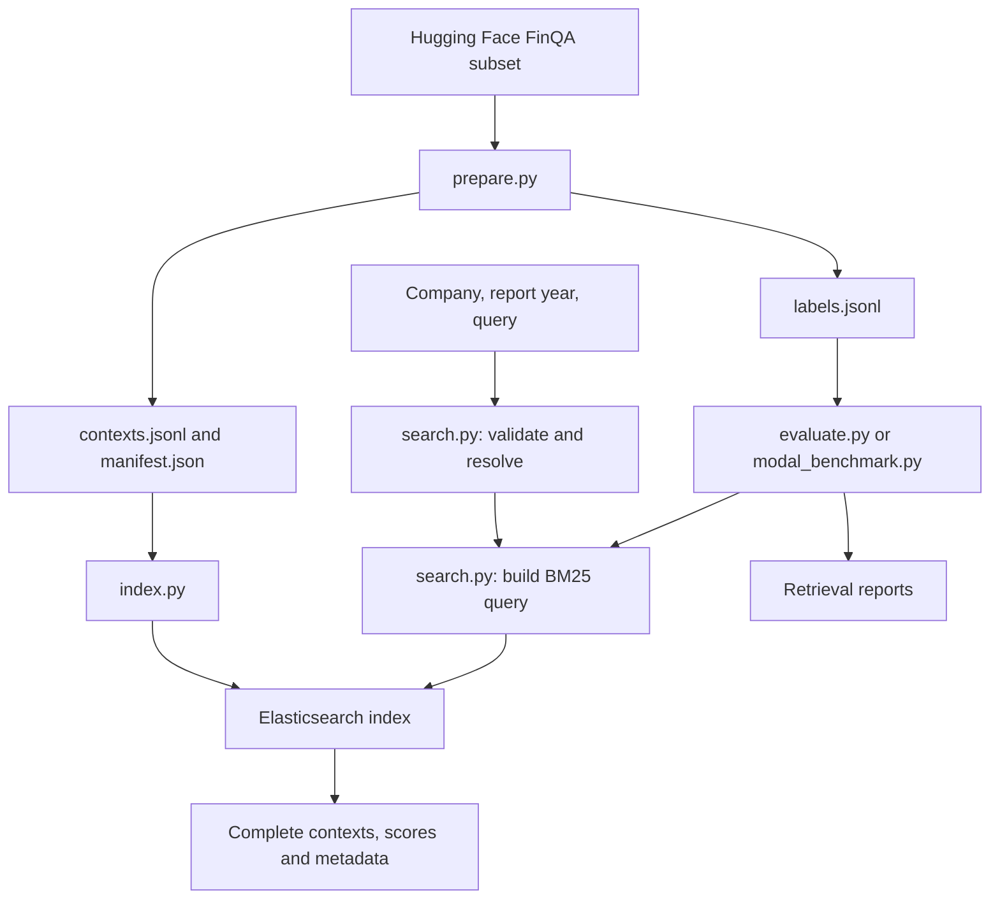

# FinanceRAG technical documentation

This is the single technical reference for the repository. It explains the
existing implementation, its files, how they connect, and what remains to be
built. The root [README](../README.md) contains commands for operating it.

## 1. What the project currently does

FinanceRAG prepares the **FinQA subset** of `G4KMU/t2-ragbench` and exposes
Elasticsearch BM25 search over its supplied financial-report contexts. A
request supplies a company name or ticker, a report year, and a text query.
Results contain complete source contexts and their metadata.

There are **2,789 unique contexts**, **799 company/year report identifiers**,
and **8,281 question rows** in the audited dataset revision. The supplied
contexts are extracted text-and-table units, not complete 10-K filings.
We do not split them into smaller chunks. Questions and answers are kept
outside the retrieval index.

The repository does not yet contain the Qwen model, GPU rollout scheduler,
reinforcement-learning trainer, rewards, or training checkpoints.

## 2. The three ways to use the system

| Mode | Entry point | Purpose | Elasticsearch location |
|---|---|---|---|
| Private Modal search | `modal_app.py` | Intended tool for future GPU rollouts | Inside each CPU search container |
| HTTP API | `finance_rag/api.py`, optionally `modal_external.py` | Local development or an external persistent Elasticsearch service | Local Docker, a VM, or Elastic Cloud |
| Kibana explorer | `modal_kibana.py` | Browse contexts in Discover and experiment in Dev Tools | A separate secured copy inside the dashboard container |

Kibana does not inspect the live cluster in a training search container.
Its copy is built from the same corpus and hash, so it is useful for reviewing
data and mappings without competing with training traffic.

## 3. Data and request flow



Preparation happens before deployment. Runtime indexing happens once per
cold search-container startup. A warm container handles many searches using
the same process, client connection pool, registry, and immutable index.

### Corpus preparation

1. Resolve a requested Hugging Face revision to its commit SHA and load only
   the `FinQA` configuration.
2. Copy the supplied text and Markdown table without changing their content.
   Convert report year and page number to integers and normalize ticker case.
3. Use CIK as company identity when available, with a ticker fallback. Combine
   company identity and report year to construct a report identifier.
4. Deduplicate by `context_id`. Conflicting content or metadata for the same
   ID causes an error rather than silently picking one row.
5. Write corpus and QA labels to separate files. Calculate a deterministic
   corpus hash, dataset counts, and split-overlap statistics.

The audited revision is `adf7fe1541ac37351ce1142544d8e3b43010ed92` and the
corpus version is `finqa-301676584646`. The current index name appends the search
schema: `finqa-301676584646-search-v2`. The CLI's default revision is
`main`; pass the audited SHA to reproduce these exact artifacts.

### Search handling

1. `SearchRequest` validates the arguments. At least one company identifier,
   an integer report year, and a nonblank query are required. Extra fields
   are rejected. `top_k` defaults to 5 and is bounded to 1–10.
2. Elasticsearch performs analyzed `match` on `company_name` using the standard
   analyzer and `operator: and`. An aggregation collects all distinct matching
   company IDs, independently of report year or requested result count.
   `Registry` intersects those candidates with an optional exact ticker,
   returns names/tickers/IDs when ambiguity remains, and checks the report year.
3. `query_body()` applies exact company-ID and report-year filters, then
   BM25 matching over `text` and `table_markdown` with `multi_match`.
4. Results sort by descending score and then ascending `context_id`, providing
   a stable tie-break. Complete `_source` documents are returned with scores.

**Year means the year of the report.** A 2002 report may contain financial
figures for 2001 and 2000; those financial periods belong in the query.
Short names such as `apple` match full names containing that word. Every word
in a multiword name must match. This is analyzed word matching, not fuzzy or
substring matching; historical aliases are still not curated. Partial or
truncated company aggregations are infrastructure errors, not a reason to
choose one company silently.

## 4. File-by-file map

### Environment, configuration, and entry points

| File | What it does | How it relates to other files |
|---|---|---|
| `README.md` | Operating commands, examples, current verification results, and limitations | Links to this document; explains how to run the entry points below |
| `technical documentation/README.md` | This single architecture and file reference | Gives the reading order and dependency map for reviewing the implementation |
| `pyproject.toml` | Python 3.11 requirement, application dependencies, dev tools, and pytest path configuration | Source configuration used by `uv` to resolve `uv.lock` |
| `.python-version` | Pins the local Python minor version to 3.11 | Read by `uv`; Modal images also request Python 3.11 |
| `uv.lock` | Exact dependency resolution, including transitive packages and hashes | Used by `uv sync --frozen`; do not edit manually |
| `requirements.lock.txt` | Export of runtime dependencies from `uv.lock`, with hashes and platform markers | Used by Modal image builders; regenerate with `uv export` after dependency changes |
| `.gitignore` | Excludes virtual environments, downloaded tools, raw/generated data, credentials, and caches | Keeps `data/kibana-credentials.json`, `.env`, and local setup artifacts out of commits |
| `.env.example` | Placeholder configuration for the external HTTP/indexing mode | Documents `ELASTICSEARCH_URL`, `ELASTIC_API_KEY`, `SEARCH_API_TOKEN`, `FINQA_DATA_DIR`, and `ES_REPLICAS`; `.env` is not loaded automatically |
| `compose.yaml` | Starts local single-node Elasticsearch 8.19.3 with a named data volume | Supports `index.py`, `api.py`, and `evaluate.py`; binds its unauthenticated port to localhost and is for local development |
| `modal_app.py` | Private `finance-rag-search` deployment, lifecycle hooks, smoke test, and Modal-to-Modal connectivity check | Wraps `EmbeddedSearch`; optionally invokes `modal_benchmark.py`; bundles corpus and manifest but not QA labels |
| `modal_external.py` | Alternative `finance-rag-search-http` deployment | Wraps `api.create_app()` and uses the `finance-search` Modal secret to connect to externally hosted Elasticsearch |
| `modal_kibana.py` | Optional `finance-rag-kibana` browser deployment and resource limits | Builds `docker/Kibana.Dockerfile`, injects generated credentials as a Modal secret, and wraps `KibanaStack` |
| `docker/Kibana.Dockerfile` | Combines matching Elasticsearch and Kibana 8.19.3 distributions | Builds only from the `docker` context; Python and locked dependencies are added by `modal_kibana.py` |

### Python package

| File | Main responsibility | Dependencies and callers |
|---|---|---|
| `finance_rag/__init__.py` | Empty package marker | Allows modules to be imported and run with `python -m finance_rag.<module>` |
| `finance_rag/prepare.py` | Dataset download, deduplication, separate exports, content hashing, and audit | Uses Hugging Face libraries; its outputs feed all runtime modes and evaluation |
| `finance_rag/search.py` | `SearchRequest`, `SearchError`, company `Registry`, corpus loading, and query construction | Shared by the HTTP API, embedded service, indexer, and evaluator; does not start Elasticsearch |
| `finance_rag/index.py` | Client configuration and `index_corpus()` | Loads corpus through `search.py`, builds strict mappings, bulk indexes, checks count, and write-blocks the corpus index; can use an injected authenticated client |
| `finance_rag/api.py` | FastAPI `/v1/search` and `/health` with bearer authentication | Uses `search.py` and `AsyncElasticsearch`; validates local hash, remote manifest hash, and remote count at startup |
| `finance_rag/embedded.py` | Elasticsearch subprocess lifecycle and private search implementation | Used by Modal search and Kibana; uses `index_corpus()` and shared request/query code; optionally enables loopback basic authentication for Kibana |
| `finance_rag/evaluate.py` | Sequential retrieval evaluation against an external Elasticsearch endpoint | Uses QA labels locally plus `Registry`/`query_body()`; records Recall@5/10, MRR@10, ranks, and exclusions |
| `finance_rag/modal_benchmark.py` | Asynchronous retrieval evaluation through Modal | Called by `modal_app.py --evaluate`; limits outstanding calls to eight, keeps labels on the caller, and records request latency and retrieval metrics |
| `finance_rag/kibana_setup.py` | Generates random passwords and encryption keys without printing their values | Creates ignored local credential and login files read by the dashboard deployment/verifier |
| `finance_rag/kibana.py` | Starts secured Elasticsearch, creates roles/users, starts Kibana, and seeds the default data view | Uses `EmbeddedSearch`; keeps admin/system passwords out of the browser login and restricts the researcher to reading corpus documents |
| `finance_rag/kibana_verify.py` | End-to-end verification of the deployed browser service | Reads local credentials, checks unauthenticated rejection and cookie login, queries via Kibana Console, then compares every returned source against the corpus hash |

`index_corpus()` owns and closes a client it creates itself. When Kibana or
the embedded service supplies a client, the caller retains ownership and
closes it during shutdown. This allows indexing and later authenticated
operations to reuse the same connection pool.

### Tests

The existing tests are organized by component so they can accompany the
corresponding commits. This organization preserves their test logic.

| File | What it checks |
|---|---|
| `tests/__init__.py` | Package marker for consistent shared-helper imports |
| `tests/helpers.py` | Synthetic context with a table, parentheses/signs, units, and a footnote; used by component tests |
| `tests/test_prepare.py` | Exact text/table preservation, QA-label separation, deduplication, split overlap, byte-level checksum, and conflicting-context rejection |
| `tests/test_search.py` | Required fields and bounds, company resolution, metadata filters, HTTP authentication, complete responses, legitimate empty results, and backend failure status |
| `tests/test_company_matching.py` | Analyzed query construction, distinct-company ambiguity, candidate metadata, ticker refinement, both API error formats, and partial-candidate failure handling |
| `tests/test_index.py` | Indexing retains ownership of an injected authenticated client and supplies the intended source documents to bulk indexing |
| `tests/test_embedded.py` | Private Modal argument errors and rejection of partial Elasticsearch responses |
| `tests/test_kibana.py` | Remote module import succeeds without reading developer-machine credential files |

The suite collects 18 test cases, including five parameterized validation
cases. Most tests inject a fake client; they do not start Java, Docker,
Kibana, or a GPU. Saved reports below provide evidence of previous live runs.

### Saved verification reports

| File | Evidence recorded | Interpretation |
|---|---|---|
| `reports/finqa-manifest.json` | Audited source revision, corpus hash/counts, lengths, blank question ID, and split overlap | Snapshot copied from the generated manifest; no raw corpus or answers are committed here |
| `reports/modal-smoke.json` | First-call duration, source preservation, metadata filters, and argument-error checks | A previous real Elasticsearch run in Modal; not a general availability guarantee |
| `reports/modal-retrieval-dev.json` | Metrics and per-question ranks/latencies for 883 development questions | Gold company/year filters and question-as-query; measures retrieval, not model tool selection or answer correctness |
| `reports/modal-deployed.json` | A second Modal container successfully calls the deployed search class | Confirms the same connection pattern intended for a future GPU caller; no GPU was used |
| `reports/kibana-verification.json` | Count, cookie login, unauthenticated 401, data view, and exact corpus-hash match | Confirms every indexed context matched the prepared corpus in the verified dashboard instance |
| `reports/company-resolution-smoke.json` | Real Elasticsearch resolves `apple`, reports all matching American companies, and accepts a refined name/ticker | Verifies the analyzed company mapping and ambiguity feedback under search schema v2 |

Reports are historical artifacts. Starting a new deployment or changing
configuration requires fresh verification; an old report does not check a
currently running instance.

### Generated local files excluded from Git

| File or directory | Purpose |
|---|---|
| `data/finqa/contexts.jsonl` | One complete source document per unique context ID; used for indexing and company registry construction |
| `data/finqa/labels.jsonl` | Question/answer rows, split membership, and support IDs; used only by evaluation and future training |
| `data/finqa/manifest.json` | Runtime corpus version, hash, counts, and audit metadata |
| `data/retrieval-baseline.json` | Default output from the external-endpoint evaluator |
| `data/kibana-credentials.json` | Local generated researcher/system/admin passwords and encryption keys; injected into Modal as a secret |
| `data/kibana-login.txt` | Only the browser username and password for the user to open locally |
| `data/review/` | Temporary local scripts and detailed Git-message files used to organize this review; not part of the application |
| `.env` | Optional private configuration file; programs read process environment variables and do not automatically load this file |
| `.venv/` | Local Python environment created by `uv` |
| `.tools/` and `uv-download.zip` | Repository-local uv executable and its downloaded archive |
| Python, pytest, and Ruff caches | Generated tool state; unnecessary for reproducing the source |

## 5. Index schema and integrity

| Fields | Mapping | Why |
|---|---|---|
| Company/report/context identifiers, ticker, CIK, and source path | `keyword` | Exact filtering, stable identifiers, stored source metadata |
| `company_name` | `text` with standard analyzer and a `keyword` subfield | Analyzed company-name resolution; use `company_name.keyword` for exact matching/aggregations |
| `report_year`, `page_number` | `integer` | Numeric metadata with explicit conversion during preparation |
| `text`, `table_markdown` | `text` | BM25 retrieval over narrative and tabular content |
| `pre_text`, `post_text` | `text` with indexing disabled | Preserve separately in `_source`; their narrative is already represented in the full context |

Mappings are strict: unexpected fields are rejected. The manifest is stored
in mapping `_meta`, alongside `search_schema_version: 2`. The index name comes from a hash of contexts sorted by
ID, serialized with sorted JSON keys and UTF-8/LF bytes, plus a schema suffix.
The corpus hash is unchanged by this mapping update. Old indexes must be
rebuilt under the new name; the HTTP API rejects incompatible schemas.
The HTTP API and
embedded service check local integrity before serving; indexing checks the
document count and blocks later writes. The HTTP API additionally checks
remote metadata/count. The Kibana verifier reconstructs the complete corpus
from all indexed sources and compares its hash, providing a stronger check
than document count alone.

These checks establish preservation of the supplied dataset contexts. They
do not verify extraction quality against every original PDF.

## 6. Runtime lifecycle, authentication, and errors

| Mode | Current resource settings | Authentication |
|---|---|---|
| Private Modal search | 2 CPUs, 4 GB RAM, 16 concurrent inputs, at most one container, zero warm minimum, 300-second idle window | Modal caller credentials; Elasticsearch listens on container loopback |
| External HTTP wrapper | 1 CPU, 1 GB RAM, 32 concurrent inputs, at most four containers, one warm minimum | Bearer token for API calls and an Elasticsearch API key for the backend |
| Kibana explorer | 2 CPUs, 6 GB RAM, 32 concurrent inputs, at most one container, zero warm minimum, 60-second idle window | Native Kibana login; secured loopback Elasticsearch; secure browser cookies over Modal HTTPS |

`EmbeddedSearch` verifies the corpus, starts Java under UID/GID 1000, waits
for Elasticsearch readiness, and builds the index. The Java attach listener
starts eagerly using `-XX:+StartAttachListener` to accommodate Modal's gVisor
runtime. Elasticsearch entitlement protections remain enabled. During
shutdown, it closes the client, stops the subprocess, and cleans temporary
files. Its subprocess code is intended for Linux containers, not direct
execution on Windows.

`SearchService.search()` uses `asyncio.to_thread()` around the synchronous
Elasticsearch operation so a call does not block the async event loop.
This permits multiple independent calls; it does not supply a GPU rollout
scheduler or guarantee any particular sustained throughput.

The private method returns `status: ok` for valid searches, including zero
matches. Invalid arguments/company resolution return `status: error` plus
an error code. Infrastructure exceptions propagate, including rejection of
timed-out or failed-shard responses. The HTTP wrapper expresses analogous
outcomes through HTTP 200, validation/company errors, 401 for unauthorized
requests, and 503 for search infrastructure failures.

Kibana startup additionally establishes passwords, creates the researcher
role, starts Node.js, waits for readiness, and creates the **FinQA contexts**
data view without a time field. Therefore no time window hides older report
years. Corpus access is read-only; the researcher can manage Kibana views.
The outer Modal web URL is public, but Kibana protects its data APIs with
native authentication. Requests can still wake a deployed container.

Both embedded modes rebuild their local indexes after a cold start. Kibana
custom saved objects are currently ephemeral. An open browser tab can send
background requests and keep Kibana active. Use `modal app stop --yes` for
a complete stop; deployment is required to make a stopped app available again.
No deployment is started by importing this document or running unit tests.

## 7. Research interpretation and unfinished design work

The audited corpus has no shared context IDs across train/dev/test, but report
identifiers do overlap. One test question, `finqa_test_490`, is blank; labels
are preserved and evaluation explicitly records the exclusion.

The saved development run reports Recall@5 of 99.43%, Recall@10 of 100%, and
MRR@10 of 0.9363. Those results use gold company and report-year metadata.
They should not be presented as end-to-end RAG or RL performance. Request
latency at concurrency eight and one successful Modal-to-Modal call also do
not establish saturation throughput or multi-hour reliability.

Before long GPU training runs, the proposed work still includes bounded
retries/deadlines, training-session warm capacity, process health monitoring,
load testing, backpressure, request caching, batch search, observation-token
budgets, version enforcement by the trainer, rollout scheduling, and durable
training checkpoints. Historical aliases, report-disjoint evaluation, and
durable Kibana saved objects are also not implemented.

All search/dashboard apps were last confirmed stopped after verification.
This is a historical status, not a live health check.

## 8. How to review the commits

The implementation is organized in dependency order:

| Commit | Scope | Suggested reading order |
|---|---|---|
| 1 | uv environment and configuration | `pyproject.toml`, `.gitignore`, `.env.example`; inspect generated lockfiles separately |
| 2 | FinQA preparation and audit | `prepare.py`, preparation tests, audited manifest |
| 3 | Company/year-filtered retrieval and HTTP API | `search.py`, `index.py`, `api.py`, tests, local/external hosting configuration |
| 4 | Private Modal CPU hosting and benchmarks | `embedded.py`, `modal_app.py`, evaluators, saved Modal reports |
| 5 | Authenticated Kibana explorer | Dockerfile, setup, `kibana.py`, deployment, verifier, regression test and report |
| 6 | Documentation | Root operating guide and this single technical document |

Use `git log --reverse --oneline` to obtain commit hashes. For each commit:

```powershell
git show --format=full --stat COMMIT_HASH
git show COMMIT_HASH
```

The first command shows the detailed message and file summary. The second
also shows the changes. Inspect lockfiles and large per-question report JSON
separately when reading the handwritten source.

For local verification:

```powershell
.\.tools\uv.exe sync --frozen
.\.tools\uv.exe run pytest -q
.\.tools\uv.exe run ruff check finance_rag tests modal_app.py modal_external.py modal_kibana.py
```

Use an installed `uv` command instead of `.tools/uv.exe` on another machine.
These checks do not redeploy Modal or start cloud compute. The root README
explains the commands that do start services.
