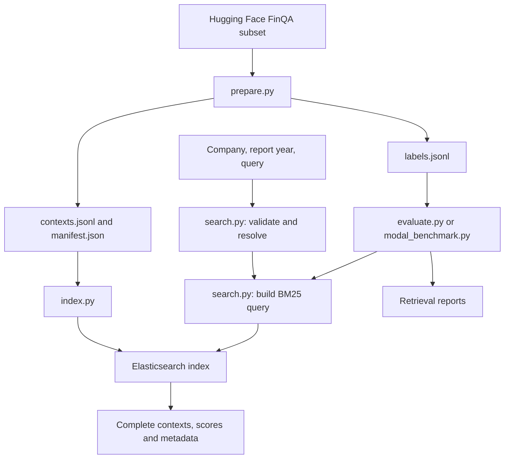

# FinanceRAG technical documentation

This is the single technical reference for the repository. It explains the
existing implementation, its files, how they connect, and what remains to be
built. The root [README](../README.md) contains commands for operating it.

## 1. What the project currently does

FinanceRAG prepares the **FinQA subset** of `G4KMU/t2-ragbench` and exposes
Elasticsearch BM25 search over its supplied financial-report contexts. A
request supplies a company name or ticker, a report year, and a text query.
Results contain complete source contexts and their metadata.

There are **2,789 unique contexts**, **799 company/year report identifiers**,
and **8,281 question rows** in the audited dataset revision. The supplied
contexts are extracted text-and-table units, not complete 10-K filings.
We do not split them into smaller chunks. Questions and answers are kept
outside the retrieval index.

The repository now contains a one-question Qwen inference baseline in
`baseline_agent/`. It does not yet contain the GPU rollout scheduler,
reinforcement-learning trainer, rewards, or training checkpoints.

## 2. Execution modes

| Mode | Entry point | Purpose | Elasticsearch location |
|---|---|---|---|
| Private Modal search | `modal_app.py` | Intended tool for future GPU rollouts | Inside each CPU search container |
| HTTP API | `finance_rag/api.py`, optionally `modal_external.py` | Local development or an external persistent Elasticsearch service | Local Docker, a VM, or Elastic Cloud |
| Kibana explorer | `modal_kibana.py` | Browse contexts in Discover and experiment in Dev Tools | A separate secured copy inside the dashboard container |
| Baseline inference | `baseline_agent/modal_app.py` | One FinQA test question on a T4, with multi-turn generation/search | Calls the independently deployed private search service |

Kibana does not inspect the live cluster in a training search container.
Its copy is built from the same corpus and hash, so it is useful for reviewing
data and mappings without competing with training traffic.

## 3. Data and request flow



Preparation happens before deployment. Runtime indexing happens once per
cold search-container startup. A warm container handles many searches using
the same process, client connection pool, registry, and immutable index.

### Corpus preparation

1. Resolve a requested Hugging Face revision to its commit SHA and load only
   the `FinQA` configuration.
2. Copy the supplied text and Markdown table without changing their content.
   Convert report year and page number to integers and normalize ticker case.
3. Use CIK as company identity when available, with a ticker fallback. Combine
   company identity and report year to construct a report identifier.
4. Deduplicate by `context_id`. Conflicting content or metadata for the same
   ID causes an error rather than silently picking one row.
5. Write corpus and QA labels to separate files. Calculate a deterministic
   corpus hash, dataset counts, and split-overlap statistics.

The audited revision is `adf7fe1541ac37351ce1142544d8e3b43010ed92` and the
corpus version is `finqa-301676584646`. The current index name appends the search
schema: `finqa-301676584646-search-v4`. The CLI's default revision is
`main`; pass the audited SHA to reproduce these exact artifacts.

### Search handling

1. `SearchRequest` validates company/ticker, year and query; top_k defaults to 2.
2. `retrieval.py` resolves issuer names or exact tickers in Elasticsearch and
   aggregates all candidates and their report years with composite pagination.
3. Ambiguous names return candidates; unavailable report years for known issuers
   return an error with available years. Neither triggers a broad fallback.
4. If an issuer name has no match, search indexed text/table with name plus query,
   without issuer/year filters, and explicitly explain this relaxation.
5. Return full contexts ranked by score then context ID. Empty results and
   infrastructure errors remain distinct. No document text is scanned in Python
   during requests, and no synonym extraction or lookup is performed.

Year means report year, rather than a financial period inside a table.

## 4. File-by-file map

### Environment, configuration, and entry points

| File | What it does | How it relates to other files |
|---|---|---|
| `README.md` | Operating commands, examples, current verification results, and limitations | Links to this document; explains how to run the entry points below |
| `technical documentation/README.md` | This single architecture and file reference | Gives the reading order and dependency map for reviewing the implementation |
| `pyproject.toml` | Python 3.11 requirement, application dependencies, dev tools, and pytest path configuration | Source configuration used by `uv` to resolve `uv.lock` |
| `.python-version` | Pins the local Python minor version to 3.11 | Read by `uv`; Modal images also request Python 3.11 |
| `uv.lock` | Exact dependency resolution, including transitive packages and hashes | Used by `uv sync --frozen`; do not edit manually |
| `requirements.lock.txt` | Export of runtime dependencies from `uv.lock`, with hashes and platform markers | Used by Modal image builders; regenerate with `uv export` after dependency changes |
| `.gitignore` | Excludes virtual environments, downloaded tools, raw/generated data, credentials, and caches | Keeps `data/kibana-credentials.json`, `.env`, and local setup artifacts out of commits |
| `.env.example` | Placeholder configuration for the external HTTP/indexing mode | Documents `ELASTICSEARCH_URL`, `ELASTIC_API_KEY`, `SEARCH_API_TOKEN`, `FINQA_DATA_DIR`, and `ES_REPLICAS`; `.env` is not loaded automatically |
| `compose.yaml` | Starts local single-node Elasticsearch 8.19.3 with a named data volume | Supports `index.py`, `api.py`, and `evaluate.py`; binds its unauthenticated port to localhost and is for local development |
| `modal_app.py` | Private `finance-rag-search` deployment, lifecycle hooks, smoke test, and Modal-to-Modal connectivity check | Wraps `EmbeddedSearch`; optionally invokes `modal_benchmark.py`; bundles corpus and manifest but not QA labels |
| `modal_external.py` | Alternative `finance-rag-search-http` deployment | Wraps `api.create_app()` and uses the `finance-search` Modal secret to connect to externally hosted Elasticsearch |
| `modal_kibana.py` | Optional `finance-rag-kibana` browser deployment and resource limits | Builds `docker/Kibana.Dockerfile`, injects generated credentials as a Modal secret, and wraps `KibanaStack` |
| `docker/Kibana.Dockerfile` | Combines matching Elasticsearch and Kibana 8.19.3 distributions | Builds only from the `docker` context; Python and locked dependencies are added by `modal_kibana.py` |

### Python package

| File | Main responsibility | Dependencies and callers |
|---|---|---|
| `finance_rag/__init__.py` | Empty package marker | Allows modules to be imported and run with `python -m finance_rag.<module>` |
| `finance_rag/prepare.py` | Dataset download, deduplication, separate exports, content hashing, and audit | Uses Hugging Face libraries; its outputs feed all runtime modes and evaluation |
| `finance_rag/search.py` | `SearchRequest`, `SearchError`, company `Registry`, corpus loading, and query construction | Shared by the HTTP API, embedded service, indexer, and evaluator; does not start Elasticsearch |
| `finance_rag/index.py` | Client configuration and `index_corpus()` | Loads corpus through `search.py`, builds strict mappings, bulk indexes, checks count, and write-blocks the corpus index; can use an injected authenticated client |
| `finance_rag/api.py` | FastAPI `/v1/search` and `/health` with bearer authentication | Uses `search.py` and `AsyncElasticsearch`; validates local hash, remote manifest hash, and remote count at startup |
| `finance_rag/embedded.py` | Elasticsearch subprocess lifecycle and private search implementation | Used by Modal search and Kibana; uses `index_corpus()` and shared request/query code; optionally enables loopback basic authentication for Kibana |
| `finance_rag/evaluate.py` | Sequential retrieval evaluation against an external Elasticsearch endpoint | Uses QA labels locally plus `Registry`/`query_body()`; records Recall@5/10, MRR@10, ranks, and exclusions |
| `finance_rag/modal_benchmark.py` | Asynchronous retrieval evaluation through Modal | Called by `modal_app.py --evaluate`; limits outstanding calls to eight, keeps labels on the caller, and records request latency and retrieval metrics |
| `finance_rag/kibana_setup.py` | Generates random passwords and encryption keys without printing their values | Creates ignored local credential and login files read by the dashboard deployment/verifier |
| `finance_rag/kibana.py` | Starts secured Elasticsearch, creates roles/users, starts Kibana, and seeds the default data view | Uses `EmbeddedSearch`; keeps admin/system passwords out of the browser login and restricts the researcher to reading corpus documents |
| `finance_rag/kibana_verify.py` | End-to-end verification of the deployed browser service | Reads local credentials, checks unauthenticated rejection and cookie login, queries via Kibana Console, then compares every returned source against the corpus hash |

`index_corpus()` owns and closes a client it creates itself. When Kibana or
the embedded service supplies a client, the caller retains ownership and
closes it during shutdown. This allows indexing and later authenticated
operations to reuse the same connection pool.

### Tests

The existing tests are organized by component so they can accompany the
corresponding commits. This organization preserves their test logic.

| File | What it checks |
|---|---|
| `tests/__init__.py` | Package marker for consistent shared-helper imports |
| `tests/helpers.py` | Synthetic context with a table, parentheses/signs, units, and a footnote; used by component tests |
| `tests/test_prepare.py` | Exact text/table preservation, QA-label separation, deduplication, split overlap, byte-level checksum, and conflicting-context rejection |
| `tests/test_search.py` | Required fields and bounds, company resolution, metadata filters, HTTP authentication, complete responses, legitimate empty results, and backend failure status |
| `tests/test_company_matching.py` | Analyzed query construction, distinct-company ambiguity, candidate metadata, ticker refinement, both API error formats, and partial-candidate failure handling |
| `tests/test_index.py` | Indexing retains ownership of an injected authenticated client and supplies the intended source documents to bulk indexing |
| `tests/test_embedded.py` | Private Modal argument errors and rejection of partial Elasticsearch responses |
| `tests/test_kibana.py` | Remote module import succeeds without reading developer-machine credential files |

The full suite collects 83 test cases with observability dependencies, including five parameterized validation
cases and seven baseline-controller tests documented in section 9. Most tests
inject a fake client; they do not start Java, Docker,
Kibana, or a GPU. Saved reports below provide evidence of previous live runs.

### Saved verification reports

| File | Evidence recorded | Interpretation |
|---|---|---|
| `reports/finqa-manifest.json` | Audited source revision, corpus hash/counts, lengths, blank question ID, and split overlap | Snapshot copied from the generated manifest; no raw corpus or answers are committed here |
| `reports/modal-smoke.json` | First-call duration, source preservation, metadata filters, and argument-error checks | A previous real Elasticsearch run in Modal; not a general availability guarantee |
| `reports/modal-retrieval-dev.json` | Metrics and per-question ranks/latencies for 883 development questions | Gold company/year filters and question-as-query; measures retrieval, not model tool selection or answer correctness |
| `reports/modal-deployed.json` | A second Modal container successfully calls the deployed search class | Confirms the same connection pattern intended for a future GPU caller; no GPU was used |
| `reports/kibana-verification.json` | Count, cookie login, unauthenticated 401, data view, and exact corpus-hash match | Confirms every indexed context matched the prepared corpus in the verified dashboard instance |
| `reports/company-resolution-smoke.json` | Real Elasticsearch resolves `apple`, reports all matching American companies, and accepts a refined name/ticker | Verifies the analyzed company mapping and ambiguity feedback under search schema v2 |

Reports are historical artifacts. Starting a new deployment or changing
configuration requires fresh verification; an old report does not check a
currently running instance.

### Generated local files excluded from Git

| File or directory | Purpose |
|---|---|
| `data/finqa/contexts.jsonl` | One complete source document per unique context ID; used for indexing and company registry construction |
| `data/finqa/labels.jsonl` | Question/answer rows, split membership, and support IDs; used only by evaluation and future training |
| `data/finqa/manifest.json` | Runtime corpus version, hash, counts, and audit metadata |
| `data/retrieval-baseline.json` | Default output from the external-endpoint evaluator |
| `data/kibana-credentials.json` | Local generated researcher/system/admin passwords and encryption keys; injected into Modal as a secret |
| `data/kibana-login.txt` | Only the browser username and password for the user to open locally |
| `data/review/` | Temporary local scripts and detailed Git-message files used to organize this review; not part of the application |
| `.env` | Optional private configuration file; programs read process environment variables and do not automatically load this file |
| `.venv/` | Local Python environment created by `uv` |
| `.tools/` and `uv-download.zip` | Repository-local uv executable and its downloaded archive |
| Python, pytest, and Ruff caches | Generated tool state; unnecessary for reproducing the source |

## 5. Index schema and integrity

| Fields | Mapping | Why |
|---|---|---|
| Company/report/context identifiers, ticker, CIK, and source path | `keyword` | Exact filtering, stable identifiers, stored source metadata |
| `company_name` | `text` with standard analyzer and a `keyword` subfield | Analyzed company-name resolution; use `company_name.keyword` for exact matching/aggregations |
| `report_year`, `page_number` | `integer` | Numeric metadata with explicit conversion during preparation |
| `text`, `table_markdown` | `text` | BM25 retrieval over narrative and tabular content |
| `pre_text`, `post_text` | `text` with indexing disabled | Preserve separately in `_source`; their narrative is already represented in the full context |

Mappings are strict: unexpected fields are rejected. The manifest is stored
in mapping `_meta`, alongside `search_schema_version: 4`. The index name comes from a hash of contexts sorted by
ID, serialized with sorted JSON keys and UTF-8/LF bytes, plus a schema suffix.
The corpus hash is unchanged by this mapping update. Old indexes must be
rebuilt under the new name; the HTTP API rejects incompatible schemas.
The HTTP API and
embedded service check local integrity before serving; indexing checks the
document count and blocks later writes. The HTTP API additionally checks
remote metadata/count. The Kibana verifier reconstructs the complete corpus
from all indexed sources and compares its hash, providing a stronger check
than document count alone.

These checks establish preservation of the supplied dataset contexts. They
do not verify extraction quality against every original PDF.

## 6. Runtime lifecycle, authentication, and errors

| Mode | Current resource settings | Authentication |
|---|---|---|
| Private Modal search | 2 CPUs, 4 GB RAM, 16 concurrent inputs, at most one container, zero warm minimum, 300-second idle window | Modal caller credentials; Elasticsearch listens on container loopback |
| External HTTP wrapper | 1 CPU, 1 GB RAM, 32 concurrent inputs, at most four containers, one warm minimum | Bearer token for API calls and an Elasticsearch API key for the backend |
| Kibana explorer | 2 CPUs, 6 GB RAM, 32 concurrent inputs, at most one container, zero warm minimum, 60-second idle window | Native Kibana login; secured loopback Elasticsearch; secure browser cookies over Modal HTTPS |

`EmbeddedSearch` verifies the corpus, starts Java under UID/GID 1000, waits
for Elasticsearch readiness, and builds the index. The Java attach listener
starts eagerly using `-XX:+StartAttachListener` to accommodate Modal's gVisor
runtime. Elasticsearch entitlement protections remain enabled. During
shutdown, it closes the client, stops the subprocess, and cleans temporary
files. Its subprocess code is intended for Linux containers, not direct
execution on Windows.

`SearchService.search()` uses `asyncio.to_thread()` around the synchronous
Elasticsearch operation so a call does not block the async event loop.
This permits multiple independent calls; it does not supply a GPU rollout
scheduler or guarantee any particular sustained throughput.

The private method returns `status: ok` for valid searches, including zero
matches. Invalid arguments/company resolution return `status: error` plus
an error code. Infrastructure exceptions propagate, including rejection of
timed-out or failed-shard responses. The HTTP wrapper expresses analogous
outcomes through HTTP 200, validation/company errors, 401 for unauthorized
requests, and 503 for search infrastructure failures.

Kibana startup additionally establishes passwords, creates the researcher
role, starts Node.js, waits for readiness, and creates the **FinQA contexts**
data view without a time field. Therefore no time window hides older report
years. Corpus access is read-only; the researcher can manage Kibana views.
The outer Modal web URL is public, but Kibana protects its data APIs with
native authentication. Requests can still wake a deployed container.

Both embedded modes rebuild their local indexes after a cold start. Kibana
custom saved objects are currently ephemeral. An open browser tab can send
background requests and keep Kibana active. Use `modal app stop --yes` for
a complete stop; deployment is required to make a stopped app available again.
No deployment is started by importing this document or running unit tests.

## 7. Research interpretation and unfinished design work

The audited corpus has no shared context IDs across train/dev/test, but report
identifiers do overlap. One test question, `finqa_test_490`, is blank; labels
are preserved and evaluation explicitly records the exclusion.

The saved development run reports Recall@5 of 99.43%, Recall@10 of 100%, and
MRR@10 of 0.9363. Those results use gold company and report-year metadata.
They should not be presented as end-to-end RAG or RL performance. Request
latency at concurrency eight and one successful Modal-to-Modal call also do
not establish saturation throughput or multi-hour reliability.

Before long GPU training runs, the proposed work still includes bounded
retries/deadlines, training-session warm capacity, process health monitoring,
load testing, backpressure, request caching, batch search, observation-token
budgets, version enforcement by the trainer, rollout scheduling, and durable
training checkpoints. Historical aliases, report-disjoint evaluation, and
durable Kibana saved objects are also not implemented.

All search/dashboard apps were last confirmed stopped after verification.
This is a historical status, not a live health check.

## 8. How to review the commits

The implementation is organized in dependency order:

| Commit | Scope | Suggested reading order |
|---|---|---|
| 1 | uv environment and configuration | `pyproject.toml`, `.gitignore`, `.env.example`; inspect generated lockfiles separately |
| 2 | FinQA preparation and audit | `prepare.py`, preparation tests, audited manifest |
| 3 | Company/year-filtered retrieval and HTTP API | `search.py`, `index.py`, `api.py`, tests, local/external hosting configuration |
| 4 | Private Modal CPU hosting and benchmarks | `embedded.py`, `modal_app.py`, evaluators, saved Modal reports |
| 5 | Authenticated Kibana explorer | Dockerfile, setup, `kibana.py`, deployment, verifier, regression test and report |
| 6 | Documentation | Root operating guide and this single technical document |

Use `git log --reverse --oneline` to obtain commit hashes. For each commit:

```powershell
git show --format=full --stat COMMIT_HASH
git show COMMIT_HASH
```

The first command shows the detailed message and file summary. The second
also shows the changes. Inspect lockfiles and large per-question report JSON
separately when reading the handwritten source.

For local verification:

```powershell
.\.tools\uv.exe sync --frozen
.\.tools\uv.exe run pytest -q
.\.tools\uv.exe run ruff check finance_rag tests modal_app.py modal_external.py modal_kibana.py
```

Use an installed `uv` command instead of `.tools/uv.exe` on another machine.
These checks do not redeploy Modal or start cloud compute. The root README
explains the commands that do start services.

## 9. One-question multi-turn baseline agent

The separate `baseline_agent/` package implements inference only. It adapts
the generation → search → information → generation interaction in
[Search-R1's inference example](https://github.com/PeterGriffinJin/Search-R1/blob/main/infer.py)
to the financial search API's company/year/query contract. This is not a port
of the Search-R1 RL trainer and does not load a Search-R1-trained checkpoint.
The model is the requested post-trained `Qwen/Qwen3.5-4B`.

| File | Responsibility and relationships |
|---|---|
| `baseline_agent/__init__.py` | Package marker; GPU libraries are imported lazily so local controller tests do not require Torch |
| `baseline_agent/pyproject.toml` | Separate Linux GPU dependency definitions: Torch 2.10 CUDA 12.8, Transformers 5.3, Accelerate, Hugging Face Hub, and Modal |
| `baseline_agent/uv.lock` | Exact independent GPU dependency resolution; does not change the root search-service lockfile |
| `baseline_agent/requirements.gpu.lock.txt` | Hash-bearing export with the PyTorch CUDA index; installed by the GPU Modal image |
| `baseline_agent/data.py` | Loads one row from the pinned test split and whitelists only question, ID, and provenance metadata for the GPU call; rejects a blank selected question |
| `baseline_agent/prompt.py` | Financial-agent instructions, tagged generated steps, structured search syntax, evidence-only answering, and final-answer formatting; no gold context or answers |
| `baseline_agent/protocol.py` | Parses only new generated actions, rejects fabricated information blocks, renders each retrieved context once, and selects append/replace history |
| `baseline_agent/agent.py` | Bounded controller with injectable generator/search callbacks, search limits, ambiguity feedback, evidence-before-answer gating, and recorded model inputs/outputs; no numeric score |
| `baseline_agent/inference.py` | Loads the native Qwen3.5 conditional-generation architecture in FP16 on CUDA, uses SDPA attention and streaming output, and stops at closing search/answer tags |
| `baseline_agent/modal_app.py` | CPU model download into a persistent cache Volume, temporary T4 inference, private Modal search calls, single-example CLI, and local transcript output |
| `tests/test_baseline_agent.py` | Tests question whitelisting, tag parsing, duplicate-free information, rolling history, fresh Qwen chat turns, ambiguity/refinement, evidence gating, and infrastructure-failure propagation |

The model emits:

```xml
<reasoning>Identify the evidence needed.</reasoning>
<search><company>Company name</company><year>2015</year><query>net revenue change</query></search>
```

Generation stops at `</search>`. The controller parses the child tags and
calls `SearchService.search.remote()` with model-chosen arguments and the
configured `top_k` (baseline default: 2). Full context formatting is preserved;
this limits the number of contexts, not their individual size. Parser feedback
names missing child fields, closing tags, and empty fields and supplies a valid
search template. Only actual service output is formatted inside
`<information>...</information>`. Candidate-company errors are supplied as
information so the model can reformulate. Infrastructure exceptions abort the
debugging run rather than being presented as evidence or a negative reward.
Generation then continues from the resulting prompt. An `<answer>` ends the
episode after at least one nonempty successful retrieval.

The service returns resolution metadata and full contexts. `protocol.py` forwards
that explanation, candidates and applied filters inside the information block,
so indirect or unrestricted retrieval is visible to the model. The previous
local `context_mention` shortcut has been removed.

The initial prompt contains the question only. It never receives the row's
gold context, answer, company name, ticker, or report year. The readiness probe
uses an unrelated Apple query to warm the CPU service before a T4 is allocated;
its output is discarded and never reaches the model.

The native Qwen chat template is rebuilt with `enable_thinking=False` for
each generation. Model outputs become assistant messages; observations become
user messages containing the `<information>` block and a continuation request.
This preserves the Search-R1 generation/search interaction while adapting its
raw assistant-continuation format to the requested ordinary chat checkpoint.
An initial test of raw continuation produced immediate EOS after evidence.
The assistant prefix is prefilled with `<reasoning>` to encourage visible
reasoning text; step tags are no longer requested. The prefill is logged
separately from generated tokens, and no
reasoning content is fabricated by the controller. Native thinking mode is
not enabled. Each generation uses a fresh prompt/KV cache so removed information
is actually absent in replace mode.

Default settings: test example index 0, five results per search, at most six
searches/eight generation turns, 1,024 new tokens per turn, and an 8,192-token
input-plus-generation budget. Sampling uses seed 42, temperature 0.2,
top-p 0.95, top-k 20, and repetition penalty 1.05. The exact model revision is
resolved and recorded for the run. GPU kernels can still introduce numerical
nondeterminism. FP16 is used because the requested T4 does not have native
BF16 support; FlashAttention-specific dependencies are not required.

Default `context_mode=replace` retains generated history and only the newest
API information block. Local controller feedback is retained separately and
does not replace retrieved evidence. `--context-mode append` retains all information blocks and
is closer to the original Search-R1 example. Full trajectories and actual
model inputs are stored externally in both modes. A token-budget violation
stops with `context_limit`; no table or context is silently truncated.

Local outputs are ignored files under `data/baseline/`: a JSON record of the
question, config, inputs, outputs, searches, timings and token counts, plus a
readable text transcript. Completed runs are archived under
`data/baseline/runs/` preserve earlier one-example runs. New evaluated runs use
`data/baseline/experiments/<run-id>/`. Number Match is now implemented locally
after inference; strict overall output-format grading and full-test evaluation
remain deferred.
Protocol parsing exists only to execute valid actions safely.

Weights are cached in the `finance-rag-qwen-cache` Modal Volume. A CPU function
downloads the snapshot before the GPU function starts. The T4 runs only for
the requested batch and stops when the temporary run completes. The separate
deployed CPU search service should be stopped explicitly after experimentation
if it should not be callable. This implementation is a debugging baseline,
not a multi-hour training infrastructure or throughput benchmark.

### Direct fallback and schema v4

`finance_rag/retrieval.py` is the shared Elasticsearch-only engine. The HTTP
API awaits it; the embedded service wraps its synchronous client in the existing
worker thread. Live services do not construct a local document Registry.
`Registry` remains a legacy offline oracle-benchmark helper.

The organization extraction module, spaCy/model dependencies, derived index
field, cache consumption and deployment mounts were removed. Schema v4 indexes
only original prepared context fields. Source integrity checks again hash full
indexed sources without excluding derived fields. Reindex external Elasticsearch
or redeploy Modal search/Kibana to use the new version. Old review artifacts can
remain on disk as historical data; no running code reads them.

| File | Responsibility |
|---|---|
| `finance_rag/retrieval.py` | Issuer resolution, report-year checks, direct broad-query fallback and response explanations |
| `tests/test_retrieval.py` | Resolution precedence, missing years, ambiguity, direct fallback, full-context observations and composite pagination |
| `reports/elasticsearch-resolution-smoke.json` | Request/response pairs from the latest temporary CPU integration check |

The baseline formatter forwards API explanations alongside intact evidence.
Model generation and historical accuracy results are unchanged.

## 10. Numeric evaluation and local observability

| File | Purpose |
|---|---|
| `baseline_agent/scoring.py` | Numeric extraction, Yes=1/No=0 normalization, Number Match, and separate sign agreement |
| `baseline_agent/evaluation.py` | Local gold/prediction comparison; incremental CSV, summary, and per-question traces |
| `baseline_agent/observability.py` | Optional TensorBoard scalar/text event files using the SDK directly, without local Torch or a hosted service |
| `tests/test_numeric_validation.py` | Scale/sign tolerance, zero handling, Yes/No conversion, invalid predictions, extreme exponents, CSV separation, and TensorBoard event roundtrip |

`data.load_evaluation_examples()` returns local evaluator pairs. Only the
whitelisted question half crosses the GPU call boundary. Gold comes from
`program_answer` and is added to local records after inference finishes.
`run_examples()` loads Qwen once, then yields each independently seeded episode
to the local evaluator. JSON/text/CSV are flushed question by question. Resume
checks question/model/config identity before skipping already completed results.

Number Match follows the supplied paper metric with epsilon 0.01: compare
absolute values, accept two values below epsilon, otherwise normalize their
ratio by the nearest power of ten and compare with one. Log differences and
Decimal arithmetic avoid float overflow for extreme ratios. Consequently a
wrong sign or a power-of-ten unit difference can pass; `sign_agrees`, original
answers, and normalized values are retained. Missing/non-numeric predictions
score zero. Yes and No, case-insensitively with optional terminal punctuation,
normalize to 1 and 0 and use the same numeric scorer. No separate text-based
boolean metric is used. Unsupported gold values are unscored and counted.

Numeric extraction accepts a single signed decimal/scientific number, valid
thousands separators, optional currency prefix, accounting parentheses, and
percent suffix (converted to a decimal). It rejects arbitrary explanation
text, multiple numbers, malformed commas, NaN/Infinity, and Python booleans.
This avoids scoring an incidental year inside an invalid answer.

`inference_seconds` is the GPU-side wall time for one episode, including model
generation and search waits. Download, image build, readiness probe and model
loading are excluded; model-load time is stored separately. Generation/search
times and token/search counts are exported alongside it. Failed episodes stay
in the CSV with their status and a zero prediction score; infrastructure failures
are distinguishable from model failures. These evaluation scores are not RL
rewards and should not be used blindly as training rewards.

Optional `--dashboard` requires the root `observability` dependency group.
TensorBoard presents score/latency/usage Scalars and per-example Text with
expected/predicted answers, generated reasoning and search requests. It binds
to localhost and sends no traces to a third party. Dashboard export failures
are logged while CSV/JSON continue. The CSV fallback is always available.
The dashboard is a local process; cloud CPU/GPU apps can be stopped while its
saved results remain viewable. LangSmith, Langfuse and Phoenix are alternatives
for richer hosted/self-hosted agent trace trees, requiring additional setup.

Old 2B experiment directories, transcripts, TensorBoard events and baseline
report snapshots were removed at user request. The baseline now uses
Qwen/Qwen3.5-4B on a T4 in FP16, with 16 GB host RAM. The current prompt,
reasoning-aware action stopping and local per-turn retrieval diagnostics remain
in place. Model revision is recorded for every new experiment. Cached model
weights are separate from experiment outputs and are retained.

The first 4B batch is experiment `34f5b1af334b`, model revision
`851bf6e806efd8d0a36b00ddf55e13ccb7b8cd0a`. It answered all first five questions
without invalid-protocol feedback and passed Number Match for all five, taking
139.68 seconds of episode inference. Gold context IDs were retrieved in four of
five cases; Entergy answered 94 using alternative evidence. Intel returned
0.1446, Analog Devices 9.86, Metavante 2.90 and Masco 1.1197. Analog Devices and
Metavante used percent-scale values instead of the instructed decimal fractions;
Number Match intentionally ignores powers of ten and accepts them. This small
debug sample also uses the revised prompt/stopping, so it is not an isolated
model-size comparison. Current snapshots are `reports/baseline-4b-first-five.csv`,
`reports/baseline-4b-first-five.json` and `reports/baseline-4b-turns.csv`.
The GPU run and search service were stopped after completion; TensorBoard is local.

### H100 pilot and resumable full-set execution

The current default GPU is H100, with pinned 4B revision
`851bf6e806efd8d0a36b00ddf55e13ccb7b8cd0a`. The earlier five-question result
remains a T4 measurement. The pilot defaults to 50 rows; `--full-test` selects
all rows and records blank questions as skipped rather than aborting selection.
Quiet generation keeps a tqdm progress bar readable; `--verbose` streams output.
All prompt and tool traces are still retained in quiet mode.

| File | Responsibility |
|---|---|
| `baseline_agent/batch.py` | Atomic JSON checkpoints, bounded call/stream retries, partial-stream deduplication, global-failure circuit breaker and error records |
| `baseline_agent/runner.py` | Local progress bar, run manifest, provenance/behavior checks, resume/selection expansion, raw-result persistence, scoring and optional dashboard handling |
| `tests/test_batch_runner.py` | Simulated stream interruption, per-example failure, retry exhaustion, disk failure, raw checkpoint recovery, failed-only retry, skip-only runs and pilot-to-full resume |

The local entrypoint creates and prints an experiment directory before setup.
`run.json` pins model, GPU, dataset, generation configuration, instruction/stop
behavior hash and search schema. A corpus/schema readiness probe runs before
model download or GPU allocation. Resume permits expanding a pilot selection,
but rejects changed behavior/provenance or a smaller selection. Completed rows
are not regenerated. `--retry-errors` repeats only infrastructure/postprocessing
failures, never simply wrong answers.

The H100 generator handles each example with try/except, retries idempotent
search calls and records unexpected failures. It releases model resources at
chunk end; CUDA OOM terminates the chunk after recording the failed question.
Default chunks contain 10 questions with a one-hour invocation timeout. Broken
streams are retried up to three attempts using only unsaved IDs; duplicate replay
is ignored. Missing outcomes after exhaustion are explicit error records. A
whole failed chunk triggers a circuit breaker, recording remaining failures
without further GPU calls.

Results and raw responses are written before the progress counter advances.
JSON/CSV snapshots use temporary files and replacement. Per-turn diagnostics
are kept compactly in memory so each checkpoint does not reread all prior large
traces. Dashboard failures disable telemetry while CSV/JSON continue. Local
scoring failures preserve raw output and produce postprocessing-error records.
Persistence failures stop execution rather than falsely report unsaved results.
`worker-errors.jsonl` and the run manifest retain failure/recovery details.
Summary includes skipped/error counts and status counts; the manifest records
invocation wall time including startup, while inference seconds exclude startup.

Validation: 74 local tests pass. Real CLI dry runs selected 50 nonblank pilot
rows and 1,147 full-test rows with one blank, without search/model/GPU calls.
No H100 inference was launched as part of this preparation. Run commands,
resume commands and try/finally CPU-service cleanup are in the root README.

### Pretrained-Only control

`baseline_agent/question_only.py` defines a separate question-only system prompt,
native chat-template adapter and one-generation controller. Its interface has no
retriever argument. It uses the same model weights, FP16, H100, per-example seeds,
temperature and per-generation token budget. No documents, API information,
gold answers or diagnostic flags reach the prompt. Search attempts are rejected
as invalid output, not executed, and there are no formatting-repair turns.
The current policy requires a best-effort number or Yes/No even when uncertain;
answering from facts/numbers already in the question is allowed. Output uses our reasoning/answer tags rather than
the paper's JSON representation, so this recreates the setting, not an exact
paper-prompt replication.

`--pretrained-only` bypasses both the worker's service lookup and the local
search/corpus preflight. The run manifest pins the evaluation mode, and RAG
resume behavior hashes remain unchanged. Question-only has its own prompt hash.
Retrieval metrics are omitted as not applicable. `baseline_agent/compare.py`
checks matching model/GPU/dataset/generation settings and identical questions
and gold answers, then reports paired gains/losses. A smaller prefix comparison
requires an explicit `--num-examples` value; it is not silently inferred.

The initial larger control run was stopped when the user limited the check to
five. Its first five genuine completed outputs were retained in experiment
`b06a90daab88` without another GPU generation. It scored 1/5 (20%) NM versus
5/5 for those same questions from RAG pilot `b836aee0ff0d`: three abstentions,
Intel incorrect, and Masco correct under scale-invariant NM. There were zero
search calls or technical failures in the five-question cohort. Masco can be
calculated directly from the question's supplied investment values, so its
success does not establish memorization. Five examples cannot establish absence
of pretraining contamination. The interrupted run is archived outside active
TensorBoard experiments; all cloud apps are stopped.

The local pipeline/source audit of the RAG 50-question pilot is saved in
`reports/h100-pilot-paper-audit.json`. Control results and paired outcomes are
in `reports/pretrained-only-first-five*`. Tests cover no tool calls, no corpus
read, question-only prompts, one generation, abstention, mode isolation and
strict paired cohort validation. There are 83 tests with observability installed.

### Forced-answer question-only control

The abstention-allowed prompt was replaced at user request with a requirement
to produce a single best numerical answer or Yes/No even if uncertain. Unknown
or nonnumeric outputs are `answer_policy_violation`; the controller never inserts
a guessed value. The checkpoint's question-only behavior hash changes, so old
control runs cannot silently resume under the new policy. RAG hashes are intact.

Fresh experiment `41b9ecf7703e` used the same first five questions, model revision,
H100 FP16, seeds and sampling settings. Every question produced a numerical
answer in one generation with zero search calls: Entergy 0, Intel 0.85, Analog
Devices 0, Metavante 0.00, Masco 1.1197. NM was 1/5 versus 5/5 for those questions
in RAG pilot `b836aee0ff0d`; inference totaled 43.49 seconds. The Masco question
contains the required investment values. This small forced-guess control does
not prove either presence or absence of pretraining memorization. Reports are
under `reports/pretrained-forced-first-five*`; earlier control outputs remain
separate. Tests pass and all cloud apps are stopped.

### Full baseline results and initial analysis

Full RAG experiment `b836aee0ff0d` scored 729/1,146 (63.61%) Number Match;
forced question-only experiment `41b9ecf7703e` scored 95/1,146 (8.29%). Both
selected 1,147 rows with one blank skipped and zero infrastructure-error outcomes.
The paired report records 662 RAG-only passes, 28 question-only-only passes,
67 both passes and 389 both failures.

`reports/full-rag-initial-findings.md` is the readable exploratory analysis.
`full-rag-initial-analysis.json` holds aggregates, definitions, limitations and
manually inspected cases; `full-rag-case-diagnostics.csv` contains one row per
scored question. `full-test-baseline-comparison.csv/json` are generated by the
paired comparison utility. The reproducible local analysis script is retained
under ignored `data/review/analyze_full_rag.py`. These exports do not change the
evaluated code, prompts, predictions, scores or dataset labels.

Canonical gold context was found for 967 questions. Of these, 700 passed,
232 answered but failed NM, and 35 produced no final answer. One hundred twenty
of 126 search-limit cases repeated an identical request. Later searches found
gold context in 70 additional questions, with 49 eventual passes; this is an
observed recovery count, not a single-turn ablation. Generation accounts for
about 98% of episode time versus about 2% for API searches.

The signed/same-scale diagnostic is 491/1,146 (42.84%), distinct from official
NM: 215 NM passes have scale discrepancies and 28 have sign discrepancies,
with five overlaps. Manual failure review also flagged likely rewritten-question
versus gold inconsistencies (notably `finqa_test_56`, whose asked 2015–2017
calculation differs from the gold's 2016–2017 calculation). Such findings do
not estimate overall annotation-noise prevalence. Benchmark scores remain
frozen; audit corresponding patterns in train/dev before choosing RL rewards.

## Evaluation dashboard

`baseline_agent/dashboard.py` serves the local read-only FastAPI dashboard and
its JSON/CSV endpoints. It discovers experiment directories containing run.json,
reads per-question scored traces, and derives diagnostics without altering saved
scores. It reuses protocol.py for action validity and scoring.py for numeric
parsing. Cached diagnostics invalidate when trace files or canonical metadata
change. Broken trace files are counted explicitly; unknown measurements are N/A.

`baseline_agent/dashboard.html` is the dependency-free browser interface. It
provides run selection, separate answer/search compliance, benchmark and signed
numeric/exact scores, timing/token summaries, evidence/outcome matrix drilldown,
search repetition and failure counts, question filtering, complete turn inspection,
and paired run comparisons. Text from model/API outputs is escaped before display.
The API binds to 127.0.0.1 and has no write endpoints or cloud calls.

The optional local data/finqa/contexts.jsonl is read for canonical company/year
metadata only, to diagnose reference-excluding applied filters. It is never used
as a retrieval fallback or passed to a model. If absent, those diagnostics are
unavailable. Gold-context identity is taken from saved retrieval_validation.
All-required-evidence coverage is not claimed because current labels identify a
single canonical context rather than a verified complete evidence set.

`tests/test_dashboard.py` checks scoring distinctions, evidence replacement,
repetition, protocol recovery, question-only N/A behavior, reference filter
exclusions, malformed-file handling, CSV export, and API access to saved runs.
Start with `.\.tools\uv.exe run --frozen python -m baseline_agent.dashboard`,
then open http://127.0.0.1:8501. Ctrl+C stops the local process. Reading runs does
not start GPU or Elasticsearch containers. Future compatible runs appear after
Refresh runs; comparisons pair only identical IDs, questions and gold answers,
show unmatched counts and flag configuration differences instead of attributing
changes automatically to RL.

### Original FinQA join and reasoning complexity

`baseline_agent/finqa_reasoning.py` optionally downloads train/dev/test JSON from
czyssrs/FinQA pinned at 0f16e2867befa6840783e58be38c9efb9229d742. It joins local
T2 labels using split and positional ID, requiring independently matching source
report/page path and original answer. Null and empty original answers are
normalized. It rejects failed checks instead of guessing from fuzzy question
similarity or numeric answer similarity. Each original ID must be used once.
It validates the flat program syntax and agrees operation count with qa.steps.

The generated data/finqa/reasoning_annotations.json sidecar includes original ID,
question, program, operators, operation count/bucket, and supporting fact IDs.
reports/finqa-reasoning-join.json records source commit, file SHA256 digests, join
coverage and distributions. FinQA train/dev/test coverage is 6251/6251,
883/883 and 1147/1147. The full scored test set excludes the pre-existing blank
question, leaving buckets of 654 one-operation, 408 two-operation, and 84 three-
or-more-operation questions. Baseline NM is respectively 431/654 (65.90%),
254/408 (62.25%) and 44/84 (52.38%). Question-only is 53/654 (8.10%),
40/408 (9.80%) and 2/84 (2.38%). Results here come from unchanged saved outputs.
Rebuilding the join report regenerates coverage; the saved_run_results section
in the current audit records this additional offline baseline aggregation.

Dashboard loading validates sidecar dataset revision, exact stripped question
and gold-answer representation against each saved trace. Unknown or stale labels
are unavailable, not assumed single-step. The sidecar is never used by inference,
retrieval, the Modal image or prompts. It supplies overview and comparison tables,
question filters and expandable original annotations. Missing sidecars are safe.
Original question/program complexity is a proxy: reformulated questions may have
changed meaning, redundant operations may be present, and several numerical
operations can use one table. Supporting rows/sentences are not separate indexed
documents, so no true multihop retrieval claim follows from these counts.

`tests/test_finqa_reasoning.py` covers successful joins, document/answer/index
mismatches, null-answer normalization, malformed programs and step-count mismatch,
and dashboard rejection of stale revisions or changed questions. Run
`.\.tools\uv.exe run --frozen python -m baseline_agent.finqa_reasoning --download`
to reproduce the join; omit --download to use previously downloaded inputs.

### Dependency depth labels (distinct from total operation count)

finqa_reasoning.program_dependencies builds a DAG from the sequential program's
#i result references. Each operation depth is 1 + max(parent depths), or 1 with
source values only. Reported reasoning_depth is the final operation's depth,
so unused earlier branches cannot inflate final-result complexity. The sidecar
stores dependency_steps, reasoning_depth, depth_bucket (1/2/3+), boolean
dependent_multistep_numerical_reasoning (depth >=2), final-result ancestors and
unused operation indices. Self/forward/malformed references fail validation.
No claim of minimum necessary reasoning depth is made; original programs can
contain redundant steps. These labels never enter model prompts or retrieval.

The dashboard's Numerical reasoning dependency depth panel and filter are
separate from Total program operations. Question details show result IDs,
operations, dependencies and node depths. Comparison tables keep both dimensions.
Later-search reference recovery is an observed trajectory diagnostic, not a
dataset reasoning label: first search misses and a later search finds the
canonical context. Recovery rate excludes no-search questions and divides by
first-search misses among searched questions; recovery accuracy divides by
recovered questions. Full RAG has 70/247 recovery (28.34%) with 49/70 correct
(70%). Filter Later-search reference recovery opens those cases.

The unchanged full-test outputs have depth buckets 657/418/71 scored questions
for depths 1/2/3+; RAG NM passes are 432/257/40 (65.75%/61.48%/56.34%).
Question-only passes are 53/41/1 (8.07%/9.81%/1.41%). The existing blank test
question has depth 2 but remains excluded from accuracy. Audit coverage remains
all 8,281 joined examples. Tests cover parallel versus chained operations,
unused branches, and malformed/self/forward dependency references.

## GRPO training foundation — review Commit 1

Scope: configuration and data boundaries only. No reward implementation,
search execution, rollout generation, trainer/optimizer, model loading or Modal
entry point exists in this package yet. Subsequent implementation commits and
paid GPU smoke tests require the user's explicit review approval.

File-by-file review order:

1. `grpo_training/config.py`: frozen TrainingConfig with explicit pinned model
   and dataset revisions, unchanged baseline search/context limits, and proposed
   GRPO/LoRA/vLLM settings. It rejects invalid types/ranges, unknown keys, unpinned
   revisions, unsupported modes and groups smaller than two. This is experiment
   intent, not a direct GRPOConfig kwargs dictionary. num_generations counts full
   episodes per question; questions_per_update * num_generations gives the logical
   episode batch. replay_microbatch_segments counts model generations replayed for
   loss, not episodes. Actual accumulation and loss are deferred. LoRA target
   modules are deliberately deferred until model inspection in Commit 5.
2. `grpo_training/configs/smoke.json`: four episodes per question, two questions
   per logical update, one replay segment per microbatch and three proposed
   optimizer steps. Unspecified fields inherit TrainingConfig defaults. This file
   does not execute training. Default config is eight episodes/four questions.
3. `grpo_training/data.py`: immutable Question and RewardLabel objects are stored
   separately in PreparedSplit. policy_messages accepts Question only and uses
   the existing baseline system prompt plus the question text. It never copies
   raw dataset fields, supplied prompt/system fields, gold answers, context IDs,
   company/year metadata, document text or original programs into the model
   prompt. Values already present in the natural-language question remain there.
   Reward labels may later reside in the trainer process; separation is a model-
   input boundary, not a claim that the trainer never sees labels.
   load_pinned_split explicitly allows train/dev only and rejects test before
   importing datasets or accessing the network. It requests the configured
   immutable Hugging Face revision. prepare_rows validates split/index IDs and
   label shape, skips blank/null questions with IDs recorded, and fails empty
   selections. It does not calculate rewards or silently repair malformed labels.
   load_local_splits reads the existing prepared QA labels for offline inspection,
   checks manifest dataset/revision/corpus and split counts, and hashes the exact
   input bytes. Existing local artifacts can contain test rows; these are never
   selected or converted into model tasks. Declared provenance is checked, not
   independently authenticated against Hugging Face; hashes expose local changes.
4. `grpo_training/provenance.py`: builds a content-addressed preflight identity
   over resolved config, selected IDs, separate model-input/reward-label hashes,
   source-file hashes and input-file hashes. Captures Git HEAD/dirty status and
   inspection Python version outside that identity. It records not_started and
   lock-resolution-only explicitly, and refuses to overwrite earlier review
   records. Root/baseline lockfiles are not modified. Report-sharing remains a
   local decision; no publishing/network calls occur here.
5. `grpo_training/inspect.py`: safe CPU-only CLI composing config → prepared local
   train/dev selections → provenance. Prints counts/identity and optionally saves
   preflight.json. No trainer, GPU model, reward scoring or cloud client import.
6. `grpo_training/pyproject.toml` and `uv.lock`: separate Linux x86_64/Python 3.11
   dependency graph for future Modal training. Stable TRL 1.15.0 exposes the
   planned rollout hook; vLLM 0.22.0 requires Torch 2.11.0 and excludes our baseline
   Transformers 5.3.0, so that environment is intentionally separate. Resolved
   versions include Transformers 5.5.4, PEFT 0.18.1, Accelerate 1.12.0 and datasets
   4.8.5. All transitive dependencies are locked. Package constraints resolve;
   package imports, model/LoRA synchronization, CUDA kernels and memory remain
   UNVERIFIED until the later approved compatibility smoke test. Model quantization is not requested; vLLM can bring quantization-related
   libraries as transitive dependencies.
7. `grpo_training/__init__.py`: package marker, no side effects.
8. `tests/test_grpo_foundation.py`: CPU tests for invalid configurations, batch
   units, label/metadata sentinel exclusion from prompts, pinned loader kwargs,
   test rejection before access, malformed/blank data handling, manifest mismatch,
   provenance sensitivity to changed labels/config, no-overwrite behavior, and a
   fresh-process assertion that inspection imports no GPU/cloud/data libraries.

Training data QA is train-only, checkpoint selection QA is dev-only. The existing
retrieval corpus still contains indexed train/dev/test document contexts, as in
the baseline; this is not report-disjoint evaluation. Gold-context diagnostics
and original program annotations do not become model inputs or rewards here.

Local review commands (from repository root):

```powershell
.\.tools\uv.exe lock --project grpo_training --check
.\.tools\uv.exe run --frozen python -m grpo_training.inspect
.\.tools\uv.exe run --frozen python -m grpo_training.inspect --config grpo_training/configs/smoke.json --train-count 4 --dev-count 4
.\.tools\uv.exe run --frozen python -m pytest tests/test_grpo_foundation.py -q
```

Optional `--output-root data/grpo/preflight` saves immutable local records under
an identity-specific folder. Repeating that write with the same identity fails
rather than overwriting a previous inspection; omit the flag to inspect again.
The full local train/dev inspection selects 6,251/883 nonblank questions. No test
questions are selected; no inference, indexing or paid compute is started.

## GRPO outcome reward — review Commit 2

`grpo_training/rewards.py` is a pure CPU outcome wrapper around the unchanged
baseline_agent.scoring.score_answer. episode_reward receives a question ID,
terminal controller status, accepted answer string/None and separate RewardLabel.
It validates ID alignment, accepted input types and known terminal statuses;
unsupported gold raises InvalidRewardLabel. An unknown status also raises rather
than silently assigning a negative reward. No raw trace/prompt parsing occurs.

| Terminal status / answer | Outcome | Reward | Number Match field |
| --- | --- | --- | --- |
| answered + numeric match | correct | 1 | 1 |
| answered + numeric mismatch | incorrect | 0 | 0 |
| answered + unparseable text | invalid_answer | 0 | 0 |
| answered + missing/blank answer | missing_answer | 0 | 0 |
| search_limit / turn_limit / context_limit / invalid_protocol / answer_policy_violation | unfinished | 0 | N/A |
| infrastructure_error / postprocessing_error | technical_failure | None (unscorable) | N/A |

EpisodeReward is frozen and contains terminal status/outcome, optional reward and
Number Match, parse validity, normalized values and sign agreement. to_dict adds
scorable explicitly. Unfinished episodes get zero even if a stale/partial answer
field happens to contain the gold value. Earlier recovered formatting failures
have no additional penalty: only the accepted terminal outcome determines reward.
The environment in Commit 3 must enforce protocol/evidence acceptance before
marking a result answered. This module does not verify search history itself.

Scoring retains the existing metric: epsilon 0.01, absolute values, nearest-power-
of-ten normalization, both absolute values below epsilon considered matching,
and Yes/No predictions mapped to 1/0. Numerical parser conventions (percent signs,
currency, scientific notation, thousands separators, accounting negatives) are
unchanged. No format bonus, retrieval bonus, length penalty, search penalty or
signed/same-scale reward is added. Sign disagreement is visible diagnostically
but does not alter reward. Reward labels/reference IDs never become model inputs.

None must never be coerced to zero or included in group-baseline calculations.
Retrying/excluding infrastructure-affected groups is deliberately NOT implemented
here: rollout/group orchestration will enforce that later. Bad gold is a data
error even for a technical-failure record, and raises before reward assignment.
No reward-model, model, TRL, vLLM, datasets or Modal import is required.

`tests/test_grpo_rewards.py` covers 42 cases: parity with the existing scorer,
boolean/zero/near-zero/tolerance/sign/scale/numeric-format cases, malformed and
missing answers, stale values on unfinished/technical episodes, invalid labels,
mismatched IDs, unknown statuses, serialization and GPU/cloud-free imports.
Offline parity checks against both full saved runs agree on every scored row:
RAG 729/1146, question-only 95/1146. The pre-existing blank question is excluded;
no new inference was performed and prediction files/scores were not modified.

## GRPO search environment — review Commit 3

`grpo_training/environment.py` provides SearchEpisode, RetryPolicy and backend
response checks. No model, tokenizer, gold labels, reward, TRL/vLLM or Modal
client is imported or instantiated. Search is an injected callable: production
binding to the existing Elasticsearch service is deferred. Tests use mocks only;
no live search or paid compute was used for this commit.

Review SearchEpisode in this order:

- Constructor accepts only the allowlisted Question plus TrainingConfig and an
  API callable. It rejects test-split questions, revision mismatch and blank
  questions. Each instance owns separate events, turns, requests, terminal state,
  answer and evidence flag. Same-question GRPO samples can share immutable config
  without sharing episode history. Feed outputs serially per episode; later
  batching will interleave separate instances rather than concurrently mutate one.
- messages() reuses the baseline question/system messages, select_history and the
  baseline observation continuation suffix. Model outputs become assistant turns;
  API information and formatting feedback become user turns. Only newest API
  information remains active, while earlier model reasoning and format feedback
  stay available. Full history remains available in defensive audit snapshots.
  The caller will apply the chat template and assistant prefill in later steps.
- accept_output() accepts one complete model segment, including any assistant
  prefill. It calls the unchanged parse_action and format_information functions.
  Invalid XML gets the same controller feedback, consumes a generation, and does
  not execute a search. Candidate/year errors are returned verbatim as escaped
  information; the environment never supplies hidden issuer/year/gold hints.
  Broad fallback stays server-owned; there is no local contexts.jsonl shortcut.
- Search limits count logical API calls, including known semantic errors. Retry
  attempts do not consume additional model turns or logical search slots. Once
  the final allowed search is executed, a subsequent answer is still allowed;
  another search request terminates search_limit. Last-turn actions are processed
  before turn_limit, matching the baseline.
- The accepted-answer evidence gate deliberately matches baseline behavior:
  any earlier nonempty successful retrieval is sufficient, even if a later search
  replaced it with empty/error results. This is NOT a requirement that current
  evidence be nonempty, canonical, or relevant. Do not change this silently when
  comparing RL to the evaluated baseline. Nonnumeric accepted answers are left
  for the existing reward scorer to reject; the controller adds no numeric reward.
- check_context_budget(input_tokens) is the explicit pre-generation boundary.
  Prompt + max_new_tokens must fit max_context_tokens; otherwise mark context_limit
  without truncation. Actual tokenization/enforcement wiring belongs to the later
  rollout/model adapter. A generic ValueError from a generation backend must not
  be guessed to mean context overflow: fail_generation records infrastructure_error.
- snapshot() is a defensive text-level audit, not the Step-4 token/logprob record.
  It contains no gold and calculates no reward. Terminal episodes reject further
  outputs. Inspection messages/snapshots cannot mutate the internal history.

Search response/failure contract:

| Backend outcome | Environment handling |
| --- | --- |
| ok + matching corpus/schema + valid documents | Format once; expose complete text/headers/footnotes without rechunking |
| ok + empty results | Normal observation; does not authorize a first answer |
| unknown_company / ambiguous_company / company_mismatch / report_year_unavailable / invalid_request | Normal API feedback, no automatic retry |
| Backend exception such as timeout/connection/incomplete-response RuntimeError | Bounded attempts; audit each exception and backoff |
| Malformed response, wrong corpus/schema, unknown error code, integration TypeError/KeyError/ValueError | Stop as infrastructure_error without retry or fake evidence |
| Attempts exhausted | infrastructure_error; no error text injected as evidence; Step-2 reward is None |

Retries default to three attempts and sleeps of 1 then 2 seconds. RetryPolicy
validates at most five attempts and finite nonnegative backoff up to ten seconds.
The injected API transport MUST enforce per-call timeouts. Python cannot abort a
hung blocking callable here: the retry policy bounds attempts, not total wall
clock. Avoid an additional outer retry wrapper; server-internal retries must be
accounted for separately when binding the production transport. The broad except
at the injected backend boundary is intentional: every failure is audited and
technical outcomes are unscorable, not silently converted to model mistakes.
Group-level retry/exclusion is deferred to rollout orchestration; this module
does not mutate group membership or compute advantages.

`tests/test_grpo_environment.py` includes 30 CPU tests. Nine scripted scenarios
compare exact chat inputs, events, search requests/responses and terminal status
against baseline_agent.agent.run_agent using its real QwenGenerator renderer with
an inert tokenizer. Coverage includes format recovery, answer-before-search,
resolution feedback, empty results, evidence replacement, sticky evidence gate,
and limits. Other cases cover interleaved independent samples, defensive copies,
HTML/tag escaping, table preservation, API-owned broad fallback, year correction,
retry accounting/exhaustion, response-contract failures, explicit context overflow,
generation failure, input boundaries and fresh-process GPU/cloud-free imports.

## GRPO rollout records and replay contracts — review Commit 4

Scope is data capture and CPU checks only. No actual model generation, vLLM,
weight transfer, GRPO advantages/loss, importance correction, optimizer or Modal
runner is implemented. The controller can execute an injected search callable
when recording outputs; this commit's tests use scripted local search only.

Review `grpo_training/records.py` first:

- PolicyVersion records immutable model/tokenizer revisions, adapter-state SHA256
  (or base), optimizer step and template identity. Its ID fingerprints these
  fields. This is an explicit claimed version, not proof of synchronization.
  Step 5 must obtain/verify actual worker state; matching echoed IDs alone cannot
  establish that a backend used the right weights.
- SamplingParameters records temperature/top-p/generation top-k/repetition penalty.
  Generation top-k is distinct from the retrieval K in TrainingConfig.
- GenerationRequest records episode/group/question/sample/turn identity, a derived
  per-turn seed, policy/sampling, exact rendered prompt text and token IDs, and
  controller assistant prefill. The fixed prefill is already part of the prompt.
  generation_seed hashes the episode seed and turn; group sample seeds must differ.
- GenerationRecord stores ONLY newly sampled completion IDs and one finite,
  nonpositive sampling logprob per token, decoded continuation, backend finish
  reason and optional timing. These are sampling-distribution probabilities, NOT
  training-engine old/current policy logprobs. The latter are deferred to Step 6.
  Controller output is prefill + decoded continuation. Decoded text is never
  re-encoded to replace the sampled token IDs; tokenization need not invert.
  Sampled EOS/stop tokens must be retained with their real logprobs even when the
  text decoder hides them. Empty/missing token records are rejected; adapters must
  not invent token IDs or probabilities to make a record fit.
- EpisodeRecord stores terminal state and all generation records, with no gold
  labels. It validates identity, ordering, policy/sampling consistency, revisions,
  token/turn bounds and the full per-turn generation reserve. It supports version-1
  JSON reconstruction, copying vectors into immutable tuples. Final answers require
  a sampled generation; only context/technical failures may have no generations.
  Optional controller_audit_json retains the full controller snapshot (requests,
  responses, feedback, events and errors) separately from replay inputs. It is an
  immutable JSON string so mutable audit dictionaries cannot change a frozen
  record. This is audit data, not an additional prompt or gold reward annotation.

`grpo_training/rollouts.py` is the text-controller/token-record boundary:

- EpisodeRecorder owns a fresh SearchEpisode. prepare(tokenizer) checks template
  identity, applies the existing chat rendering settings, appends the baseline
  assistant prefill and encodes without extra special tokens. It stores those
  exact IDs and checks the prompt-plus-generation-reserve budget before sampling.
  Explicit context overflow returns no request and fabricates no sampled tokens.
- One generation may be pending per episode. record() requires backend-reported
  prompt IDs, policy ID and sampling parameters matching that request. It validates
  completion/probability lengths and token bounds before advancing the controller.
  It decodes only to process XML; it never reconstructs token IDs from text.
  EOS, action and length endings remain explicit. Truncation masking decisions
  belong to the later loss implementation, not this capture layer.
- Template identity covers the supplied chat template, system prompt, continuation
  suffix, prefill and rendering options. It does not authenticate a tokenizer
  vocabulary or checkpoint; actual revision/runtime verification remains Step 5.
- fail_generation marks a technical failure without fabricated completion tokens.
  finish requires a terminal controller and no pending request. Out-of-band
  controller generation history changes fail rather than silently lose turns.

`grpo_training/replay.py` preserves grouping and masks by token origin:

- QuestionGroup requires exactly config.num_generations complete episodes of the
  same question/config/policy/sampling with distinct IDs/seeds and sample indices
  0..G-1. A question group is NOT a group of individual turns. Any technical failure
  makes the whole group unscorable; replay raises GroupRequiresRetry rather than
  dropping only failed peers. Retry/exclusion orchestration is still deferred.
- replay_rows produces one teacher-forcing row per recorded generation, preserving
  group/episode/sample/turn IDs. input_ids is that generation's original prompt
  followed by its original completion. Older evidence removed before that turn is
  not reintroduced. Prompt tokens have loss_mask 0 and labels -100; newly sampled
  tokens have loss_mask 1 and their original target IDs. Earlier model reasoning
  copied into a later prompt stays masked, so it is not counted again as output.
  Masking is by origin, never by searching for information tags in generated text.
- logit_positions selects the preceding-token logits for each completion target:
  if prompt length P and completion length C, positions are P-1 through P+C-2.
  Labels remain in target-token coordinates for the usual causal shift.
- Replay rows are unpadded plain Python sequences. Sampling logprob zeros on
  prompt positions are placeholders and must be masked, never interpreted as
  actual environment-token probabilities. No Torch tensor, loss normalization,
  reward broadcasting or advantage computation occurs here. The trainer's
  `collate_segments()` is the sole padding/tensor collator; the unused original
  combined-sequence collator was removed after integrating TRL.

`tests/test_grpo_replay.py` has 20 CPU cases. They cover exact replacement prompts,
old reasoning versus new targets, normalized toy teacher-forcing probability
agreement, wrong-context disagreement, unequal-length replay rows, sampled EOS,
JSON round trips, probability/token validation, stale backend policy/prompt/
sampling acknowledgments, missing/duplicate/mixed groups, infrastructure-group
blocking, context/generation failures, pending-request discipline, and preventing
unrecorded controller advancement. GPU/cloud packages are not imported. These
verify contracts; they do not validate real tokenizer, CUDA kernels, vLLM sampling,
weight synchronization, gradients or actual GRPO updates.

### GRPO Commit 5: model loading and vLLM boundary

`grpo_training/model.py` contains the explicit GPU model loader and adapter
transfer format. Importing this file is CPU safe: Torch, Transformers, PEFT and
Hub imports happen only inside the loader. The loader requires Linux x86_64,
Python 3.11 and the reviewed library versions from the isolated training lock.
It resolves the pinned Hub snapshot, uses its local tokenizer and checkpoint,
requires CUDA/BF16, disables remote code and rejects quantized checkpoints.

The initial policy is the existing Qwen3.5-4B revision. All original parameters
are frozen before attaching rank-16, alpha-32 LoRA with zero dropout. Targets are
explicit text full-attention q/k/v/o projections and MLP gate/up/down projections.
Vision, embeddings, output head and hybrid linear-attention-specific projections
remain frozen. This conservative target choice can be expanded after compatibility
tests. Gradient checkpointing uses the non-reentrant path; only expected LoRA A/B
parameters may remain trainable. No optimizer or gradient update is created here.

`TrainingModel` holds the loaded policy, tokenizer, snapshot path, config and
selected module names. `export_adapter()` writes PEFT adapter weights/config and
`transfer.json` beneath a caller-selected directory named by PolicyVersion.id.
The manifest binds individual file hashes, combined adapter hash, optimizer step,
model/tokenizer revision, template identity, target names and experiment config.
Exports do not overwrite existing identities. Verification detects changed bytes,
manifest inconsistencies and unexpected LoRA settings. These transfer files are
not optimizer/resume checkpoints or a persistent trajectory store. Persistence
and crash recovery remain a later step; interrupted exports fail verification.

`grpo_training/vllm_backend.py` is the sampling boundary:

- `create_vllm_backend()` explicitly allocates a colocated vLLM engine using the
  same local snapshot/tokenizer and BF16, without quantization. It checks tokenizer
  vocabulary/EOS agreement, uses spawned workers, disables image/video inputs,
  enables sleep mode and initially uses eager execution without prefix caching.
  Its default 30% GPU-memory utilization is provisional, pending GPU measurement.
- `VLLMBackend.synchronize()` verifies an exported artifact and experiment identity,
  loads it under a new positive LoRA ID, checks the engine registry, retires the
  previous adapter and clears prefix caches. New versions require a strictly newer
  optimizer step. Failed load acknowledgments clear the active policy and block
  generation. Registry acknowledgment is not proof of numerical weight parity;
  a real GPU comparison is still required. Weights are transferred as adapters,
  without merging them into the base checkpoint.
- `generate()` accepts multiple `GenerationRequest` objects so vLLM can schedule
  them together. A lock prevents overlapping synchronization/sleep/generation
  operations. Requests with stale policies, duplicate episode/turn IDs, changed
  experiment sampling or excessive token budgets are rejected. It checks the
  returned prompt IDs and LoRA identity for every output, and retains selected
  token logprobs without reconstructing token IDs from text.
- Sampling requests `processed_logprobs`, which include temperature and sampling
  processing. The later replay/loss step must use the corresponding distribution
  when computing ratios. Raw, unscaled policy logprobs are not interchangeable.
  The pinned vLLM implementation documents these modes in its
  [model config](https://github.com/vllm-project/vllm/blob/v0.22.0/vllm/config/model.py)
  and [sampler](https://github.com/vllm-project/vllm/blob/v0.22.0/vllm/v1/sample/sampler.py).
- String stopping includes closing search/answer tags in sampled output. The
  existing baseline `action_complete()` still decides whether an action is done.
  A quoted closing tag inside reasoning can stop an engine call prematurely; the
  backend resumes with the exact sampled token prefix and remaining token budget,
  deriving the continuation seed deterministically. This stays one controller
  generation, with no intervening tool observation. EOS and length terminations
  retain their own identities. Tokens after the first complete action are excluded.
- `GenerationBatch` reports whole-batch wall time. `BackendGeneration` retains
  tokens, logprobs, ending and engine-call count, and `record_into()` advances the
  existing EpisodeRecorder. It does not invent per-sample timing from batch time.

The intended flow is: load TrainingModel → export adapter version → create/wake
vLLM → synchronize → prepare requests with EpisodeRecorder → generate batch →
record outputs into their individual controllers. A later trainer will repeat
this after optimizer updates and coordinate memory phases. This commit does not
wire a live search client, compute advantages/GRPO loss, synchronize distributed
workers, launch Modal, or persist run checkpoints.

`tests/test_grpo_model_backend.py` provides 22 CPU cases: lazy imports, pinned
loader arguments and base freezing, text target selection, content-addressed
exports, tamper detection, version transitions, failed acknowledgments, sleep and
missing adapters, batched token/probability capture, corrupt engine outputs,
quoted-tag continuation, EOS/length endings, duplicate/stale requests, sampling
settings and tokenizer disagreement. Fake adapter bytes are not real safetensors;
these tests establish contracts, not CUDA/kernel/LoRA compatibility. The full CPU
suite passes 234 tests. A separately approved GPU smoke must establish real model
loading, PEFT-to-vLLM target mapping, changed-weight behavior, finite logprobs,
teacher-forcing probability agreement within an explicit tolerance, and memory
feasibility before any training run.

### GRPO Commit 6: complete-episode advantages and native TRL loss bridge

Read `grpo_training/advantages.py` before `trainer.py`. `prepare_update(groups,
labels)` requires exactly questions_per_update complete QuestionGroups, one
policy/config, unique question/group/episode IDs and train-only questions. Reward
labels must match the question IDs exactly. A technical failure rejects the
entire update; this layer does not silently drop peers or retry groups. Labels
are consumed by the existing terminal Number Match scorer and are not retained
in PreparedUpdate or passed to the model.

`EpisodeSignal` stores episode/group identity, terminal 0/1 reward and advantage.
For group g, its baseline is the arithmetic mean of all G episode rewards:

```text
A_i = (reward_i - mean_reward_g) / (sample_std_reward_g + 1e-4)
```

The group standard deviation uses Bessel correction, matching pinned TRL. The
existing scale_rewards options also support one update-wide sample standard
deviation (batch) or no scaling (none); centering always remains within question.
All-correct/all-wrong groups have zero advantages and remain in the batch. A
context-limit episode with no sampled tokens still contributes its zero outcome
to its group's baseline, although it has no tokens to backpropagate through.
An update with no sampled tokens is rejected explicitly.

`PreparedUpdate` retains immutable episode records and learning signals. rows()
creates fresh per-generation replay rows and broadcasts each episode's advantage
to its turns. It does not treat turns as independent GRPO samples. token_count
is the total number of sampled completion tokens across all turns and groups,
including EOS and length-truncated output. Truncated output is not silently
discarded; unfinished episodes retain the existing zero terminal reward. There
are no extra format/retrieval/process rewards or dynamic group filtering.

`grpo_training/trainer.py` provides the explicit boundary to TRL:

- `validate_replay_config()` initially supports loss_type=dapo, beta=0, top_p=1
  and zero adapter dropout. The capture path additionally rejects generation
  top-k filtering or repetition penalties. These restrictions keep the training
  distribution compatible with the processed sampling probabilities. Other
  TrainingConfig values can describe future experiments, but unsupported loss
  modes fail before this bridge executes them.
- `create_replay_trainer()` constructs a normal GRPOTrainer subclass using the
  already loaded policy and tokenizer. Only allowlisted train Question prompts
  enter its dataset. Its placeholder reward callable raises if accidentally used:
  scoring must happen on complete controller-accepted episodes. The subclass
  blocks built-in train() and transcript generation. It inherits TRL's native
  compute_loss, clipped objective and temperature-scaled fused forward unchanged.
- `use_vllm=False` in GRPOConfig means TRL must not create a second sampler or
  synchronize weights itself. The experiment still uses the Step-5 colocated
  VLLMBackend externally. The later orchestration layer will own both components.
  The bridge currently requires one process, TRL accumulation factor 1 and
  steps_per_generation 1. Variable numbers of turn microbatches are accumulated
  explicitly, rather than pretending there is a fixed number of turns per episode.
- `capture_update(trainer, prepared, artifact, bundle)` runs before any update.
  It checks the artifact/policy/global-step identities, verifies the trainer owns
  the supplied TrainingModel, and re-exports current adapter bytes to ensure the
  live training policy still matches the sampled one. Existing transfer identities
  now also reject different experiment manifests instead of silently reusing them.
  It switches to eval mode, teacher-forces every actual per-turn prompt/completion
  under torch.no_grad(), and restores the preceding model mode even on failure.
  Native TRL performs the causal shift. The saved old probabilities are finite
  Python float tuples, with no graph or model references attached to them.
- `CapturedUpdate` binds these old logprobs and correction vectors to PreparedUpdate.
  It freezes nested vectors and checks token alignment and numerical bounds.
  Per-token vLLM correction is c = min(exp(old_logprob - sampled_logprob), 2).
  The cap is configurable; disabling correction gives c=1. Clamping the log ratio
  before exponentiation avoids overflow. Ratios can underflow to zero for extremely
  small probabilities. These fixed corrections account for sampling/training
  mismatch; PPO's current/old ratio separately accounts for subsequent updates.
- `collate_segments()` converts replay rows to TRL inputs, left-padding prompts
  and right-padding completions. Real prompt/completion IDs are preserved. Masks
  derive from lengths, so EOS stays active even when it equals the padding ID.
  Prompt tokens are never completion targets, and removed search observations
  are never reconstructed or concatenated into a different trajectory transcript.
- `loss_microbatches()` supplies detached old logprobs, completion masks and one
  shared whole-update token denominator. It folds c into the token advantage:
  min(r*A, clipped_r*A)*c = min(r*(A*c), clipped_r*(A*c)) for nonnegative fixed c.
  TRL's vLLM loss path stays off, so correction is applied exactly once. This
  equivalence requires the guarded settings: no KL, entropy bonus, entropy-token
  filtering, auxiliary loss, off-policy mask, two-sided ratio cap or sequence-level
  importance ratios. Native clipping diagnostics see correction-weighted advantages;
  those are not additional outcome rewards.
- `backward_update()` clears preceding gradients, runs each microbatch through
  native TRL compute_loss, and invokes Accelerator.backward. The current-policy
  forward creates the autograd graph here. The loss uses ratio exp(current-old),
  lower/upper clipping 1-0.2 and 1+0.28, and the shared sampled-token denominator.
  There is no second division by the number of microbatches. Backward releases
  each graph before processing the next turn. Any raised failure clears partial
  gradients and propagates; it is never converted to a reward or successful step.

The caller still owns optimizer creation, gradient clipping/nonfinite-gradient
checks, optimizer/scheduler stepping, incrementing global_step, adapter export,
vLLM sleep/wake/synchronization, rollout scheduling, checkpointing and logging.
No production optimizer is stepped in this commit. Reusing a captured update is
allowed for config.num_iterations optimizer steps; its old logprobs/corrections
stay fixed. The bridge rejects reuse once global_step reaches that bound or moves
backward. The default remains one iteration. This implements TRL's DAPO loss
normalization, not every mechanism from the full DAPO training recipe.

The intended call order is:

```text
Independent sampled episodes + separate reward labels
  → prepare_update()             # complete-group rewards/advantages
  → capture_update()             # fixed old logprobs, no graph
  → backward_update()            # differentiable current forward + native TRL loss
  → [later runner] clip gradients, optimizer.step(), scheduler.step(), global_step++
  → [later runner] reuse within limit or export/synchronize before fresh rollouts
```

`tests/test_grpo_advantages.py` has 17 dependency-light cases covering group
centering/scaling, unequal trajectories, zero-variance groups, zero-token context
failures, technical failures, train-only and ID constraints, clipping config and
lazy imports. `tests/test_grpo_trainer.py` has 18 optional CPU cases using pinned
Torch 2.11.0+cpu, TRL 1.15.0, Transformers 5.5.4, Accelerate 1.12.0, PEFT 0.18.1
and datasets 4.8.5 in an ignored environment under data/. They exercise the real
TRL objective with a tiny frozen-base/two-adapter probability model: detached old
capture versus differentiable replay, both clipping branches, exactly-once/capped
sampling correction, unequal microbatch/full-batch gradient agreement, zero policy
gradients for zero advantages, EOS/padding masks, changed live weights, rollout
reuse, unsupported settings, and discarding partial gradients after failures.
One constructor/wrapper test uses a tiny GPT-2 and a reference CPU LM-head kernel
because TRL's actual fused kernel requires Triton/CUDA. No real Qwen model,
Triton kernel, Elasticsearch service, vLLM engine or Modal job runs in these tests.
The reproducible CPU environment commands are in the root README.

The implementation follows the pinned
[TRL GRPO trainer source](https://github.com/huggingface/trl/blob/v1.15.0/trl/trainer/grpo_trainer.py)
for advantage standardization, temperature-scaled old/current probabilities,
clipping and DAPO token normalization. GPU numerical agreement and actual training
remain separate approval/validation steps.

### GRPO Commit 7: collection, update orchestration, checkpoints and Modal

`grpo_training/collection.py` implements `collect_groups()` around the existing
SearchEpisode/EpisodeRecorder pair. Each question gets G fresh independent
recorders and deterministic sample seeds derived from experiment seed, round,
question, group attempt and sample index. At each turn it prepares all active
requests, calls VLLMBackend.generate once, verifies returned membership/order,
then records outputs into their individual controllers. Recording can execute
search calls on at most four worker threads; no controller is shared by threads.
The search deployment itself remains unchanged (its concurrency limit is 16).

Semantic API feedback, invalid model syntax and controller limits remain model
outcomes. Only terminal infrastructure failures trigger up to two whole-question
attempts. All G peers of a failed question are regenerated with a new attempt
seed; successful other question groups remain intact. Every attempt is audited.
The controller still owns its three per-search attempts/backoffs, so the two
bounded retry levels are explicit. Generation exceptions, including OOM or bad
backend token records, abort the job because the engine may be unhealthy. There
is no automatic in-process GPU reset or reward-zero substitution.

`grpo_training/runner.py` owns the production update order:

1. Validate train-only inputs, numeric labels and exact run identity. Select a
   deterministic cyclic batch of distinct questions from the prepared selection;
   there is no shuffle or test-set access. The cursor is checkpointed.
2. Export the current LoRA policy. Before a fresh rollout, release unused Torch
   allocator memory, wake vLLM if asleep, and synchronize the exported adapter.
3. Collect all required question groups and put vLLM to sleep. Version 1 sleep
   offloads inference weights and discards KV allocation; training remains resident.
4. Compute terminal rewards/advantages and capture fixed old-policy logprobs on
   exact saved turn inputs. Audit mean/max absolute differences from sampled
   logprobs. Fresh captures must satisfy mean <=0.1 and max <=1.0 logprob units.
   These are conservative initial diagnostic thresholds, not measured H100
   tolerances; they must be reviewed against the GPU smoke results. Failure aborts
   before updating, without silently loosening the limits or changing rewards.
5. Accumulate native TRL replay gradients. Clip trainable gradients to max_grad_norm
   and reject nonfinite norms before optimizer.step. Refuse to advance if Accelerate
   reports a skipped optimizer step. Step the scheduler and increment global_step
   exactly once, then clear gradients to release memory before inference resumes.
6. Export the updated adapter and save a checkpoint after every successful step.
   If num_iterations allows rollout reuse, preserve the original captured old
   logprobs/corrections and continue replay; do not generate between reuse steps.
   Otherwise wake/synchronize only when the next rollout is needed. max_steps
   bounds optimizer steps, including when it ends partway through a reused batch.

`initialize_optimizer()` explicitly prepares the model and Trainer-created
optimizer/scheduler with Accelerate, without invoking Trainer.train().
`optimizer_step()` performs clipping, finite checks, stepping and step accounting.
`run_training()` has injectable boundaries for CPU control-flow tests; the Modal
entrypoint uses the real implementations. Failed optimizer/scheduler/export/save
operations abort and never publish a checkpoint of a partially mutated step.
The last completed checkpoint is the restart point. Initial step zero is saved
before engine construction as well as at loop entry, so failed vLLM startup has
a recovery point after model/trainer initialization.

`grpo_training/checkpoints.py` provides the run store and recovery contract:

- `RunStore` requires a simple run name and refuses to overwrite an existing run.
  Resume requires the exact stored identity. `run_identity()` records config,
  selected question IDs/prompt hash, separate reward-label hash and all training
  source hashes plus the GPU pyproject/lock and baseline prompt/protocol/scorer.
  Git status and absolute local paths are excluded, allowing the same identity
  on Windows and Modal. `provenance.training_source_hashes()` is shared with the
  earlier preflight implementation; the scorer is now included explicitly.
- `Progress` tracks completed optimizer step, next-question cursor, next rollout
  round and next iteration within the pending rollout batch. Adapter policy step
  must agree with completed step. Pending trajectories may correctly have an
  older sampling policy when several optimizer steps reuse the same rollouts.
- Each checkpoint contains an adapter directory, state.json, training.pt and a
  manifest of hashes for those files. state.json stores progress/current policy,
  and any pending complete trajectory groups, episode signals, fixed old logprobs
  and correction vectors. training.pt stores optimizer/scheduler states and Python,
  NumPy, CPU Torch and all visible CUDA RNG states. NumPy state is converted to
  ordinary values so training.pt can be loaded with torch.load(weights_only=True).
- Writes go to a unique `.partial-*` directory. Only after serialization finishes
  is that directory renamed to a completed checkpoint name, followed by replacing
  latest.json. Open files are closed before the injected durable callback commits
  the Modal Volume. Partial directories and orphaned completed directories are
  not automatically treated as latest. There is no automatic rollback from a
  corrupt latest checkpoint or claim of a distributed atomic volume transaction.
- Restore verifies identity and every allowlisted file hash before deserialization.
  It loads PEFT tensors into the existing adapter, rejects missing/unexpected LoRA
  tensors, and re-exports to verify the restored policy hash. Optimizer/scheduler
  states and global_step are restored. Pending rewards/advantages are recomputed
  from separate current labels and compared with saved signals. Reuse position
  must agree with the old sampling policy step and configured iteration limit.
- RNG restoration happens after fresh model/trainer/vLLM construction, which can
  consume random state. The selected-data cursor and deterministic rollout seeds
  avoid needing a DataLoader sampler checkpoint. This does not promise bitwise GPU
  equivalence across CUDA kernels, backend batching, service latency or hardware.
- Timestamped unique event files preserve whole rollout attempts (including full
  controller audit and per-turn token records), generation-batch timing, probability
  differences, optimizer metrics and errors. Labels/gold contexts are not added to
  prompts or search calls. Every-step checkpoints/full smoke traces are deliberately
  verbose; storage retention/sampling and richer dashboards remain later work.

`grpo_training/modal_app.py` defines resources without invoking them on import:

- The CUDA 13.0.2 development image uses Linux Python 3.11 and Modal's uv_sync with
  uv 0.13.0 and the frozen independent GPU lock. Source packages are added after
  dependency installation. The root/baseline Python environment remains unchanged.
- `warm_model` downloads the pinned snapshot to a cache volume on CPU, commits it,
  and probes the existing Elasticsearch service against a known Apple report.
  Corpus/schema and nonempty results must match before allocating the H100 job.
  The diagnostic response is not supplied to training prompts.
- `train_run` uses one H100, four CPUs, 32 GiB host memory, no automatic Modal
  retries, no minimum warm GPU containers, a 24-hour deadline and a single-use
  container. An atomic Modal Dict put-if-absent claim protects each run ID even
  across separate app invocations. Normal completion/failure commits the run volume
  and releases only its own lock. Hard termination can leave a stale lock; it must
  not be removed until the old job is confirmed stopped.
- The GPU worker checks local/remote source/data identity, initializes model and
  Trainer, restores a requested checkpoint, creates vLLM and binds the deployed
  SearchService. The search transport applies an asyncio deadline of 45 seconds
  across submission and response waiting for each controller attempt. A timeout
  allows up to two additional seconds for best-effort cancellation without
  terminating the shared search container. SearchEpisode owns retry/backoff.
- Default local-entrypoint arguments select the reviewed three-step smoke config
  and first 16 source rows of the prepared training split (blank questions skipped).
  The root README contains explicit later-run/resume/stop commands. No entrypoint,
  image build, service call, deployment or paid GPU invocation was executed for
  this implementation commit. Volume persistence follows the official
  [Modal volume commit guidance](https://modal.com/docs/guide/volumes).

`tests/test_grpo_runner.py` has 11 dependency-light cases for phase order, batch
reuse, checkpoint boundaries, continuation after interruption, probability guards,
optimizer failure, identity checks, batched episodes, bounded whole-group retries,
generation aborts, context limits and lazy imports. `tests/test_grpo_modal.py` has
four local-fake cases for exclusive/owner-checked run locks, submission/response
deadlines and cancellation that preserves the search container. Imports construct Modal resource
descriptions but do not hydrate resources, build an image or call remote functions.

`tests/test_grpo_checkpoints.py` has 10 optional CPU cases using real Torch/PEFT
adapter serialization and optimizer states: adapter/scheduler/RNG round trips,
pending rollout reuse, identical next optimizer update after resume, corrupt files,
interrupted writes, unsafe pointers, policy-step mismatch and nonfinite gradients.
The native TRL constructor test also exercises real Accelerate model/optimizer/
scheduler preparation and stepping using its reference CPU LM-head kernel.
These establish local contracts; Qwen LoRA mapping, real vLLM sleep/wake and weight
synchronization, H100 memory peaks and probability tolerances still require the
separately approved compatibility smoke before a research training run.

## Commit 8: training observability and live dashboard

The existing training loop now records observability without changing rewards,
advantages, the DAPO loss, or beta=0. No GPU job or remote deployment was launched
for this step. All implementation checks are local CPU checks.

File responsibilities and connections:

- `baseline_agent/diagnostics.py` contains the baseline dashboard's shared pure
  episode diagnostic function, moved without changing its definitions. Both the
  baseline dashboard and GRPO metrics import it, so reference hits, format errors,
  repeated requests/sets, no-new-context and failure labels agree.
- `grpo_training/metrics.py` converts complete grouped EpisodeRecords and separate
  RewardLabels into diagnostic traces, per-episode records, group statistics and
  pooled numerator/denominator rates. GenerationRequest/GenerationRecord token
  counts remain authoritative. Reference metadata retains only company ID and
  report year for diagnostic exclusion checks; no document text is a retrieval
  shortcut. Gold answers/context IDs never enter model prompts or search calls.
- `collection.py` reports active/completed trajectories and generation/search
  phases to the observer. Completion order is observed as search futures finish.
  Engine batch seconds and token counts are measured jointly; they are not
  fabricated into individual generation latency. Per-trajectory collection time
  includes waiting and tool calls. Detailed events preserve failed group attempts.
- `grpo_training/observability.py` owns atomic JSON files, TensorBoard events,
  phase/progress publication and loss instrumentation. The runner initializes it,
  sends collection events, registers each fresh rollout, wraps replay/backward,
  measures reference KL after the optimizer update, and publishes the step after
  its checkpoint succeeds. TensorBoard/volume flushes occur at most every five
  seconds during progress, plus forced checkpoint/completion boundaries; UI
  freshness also depends on remote volume visibility and mirror latency.
- `grpo_training/reference.py` creates a fixed probe from the first four selected
  training questions (configurable with reference_probe_questions). For each,
  it uses exactly the initial generation prompt and measures the next-token
  distribution across the full vocabulary. The original base distribution is
  cached on CPU with adapters disabled and hash-checked on resume. The current
  distribution is measured at step zero and after EVERY optimizer step, with
  training temperature, no top-p filtering, evaluation mode and no gradients.
  RNG and training mode are restored. This is KL(current || original pretrained),
  averaged across probe positions in nats, not a full-trajectory KL. It is a
  monitor only and does not add a reference penalty to the loss. It requires
  extra policy forward passes; their duration is recorded separately.
- `grpo_training/dashboard.py` serves a read-only localhost dashboard and CSV
  endpoints. Its optional ModalMirror downloads only existing observability and
  TensorBoard files from finance-rag-grpo-runs, retaining the last good data on
  network errors. It does not invoke a GPU function. Immutable files are reused;
  index/live files and changed TensorBoard files refresh periodically. The reader
  includes only checkpoint-committed steps and deduplicates reused rollout IDs.
- `grpo_training/dashboard.html` is the offline browser UI with a five-second
  refresh, raw and smoothed charts, tables, filters and expandable episode traces.
  The existing baseline UI on port 8501 is independent; training defaults to 8502.
- `grpo_training/trainer.py` supplies the current microbatch inputs to the metrics
  collector. The collector observes detached copies of existing log-probability
  outputs, then returns the original tensors and computational graph unchanged.
  It adds no extra replay forward pass. The isolated GPU dependency lock adds
  TensorBoard; the root environment/lock are unchanged.

Metric timing, units and denominators:

- Loss, pre-clipping gradient norm, learning rates, token count and PPO diagnostics
  are raw per optimizer step. Loss is computed before that update; reference KL
  is measured after it. A 20-step UI window is only a display aggregation, with
  all-history and other window options. Loss windows weight by generated tokens;
  rate windows sum counts before division. Distribution standard deviations use
  sample standard deviation; undefined measurements display N/A rather than zero.
- Reward/Number Match, signed numeric match, normalized exact match, format,
  evidence and search behavior belong to unique fresh rollout batches. Rollout
  reuse does not multiply these samples. Infrastructure failures are unscorable,
  and failed collection attempts remain in raw audit events rather than becoming
  incorrect-answer rewards. All-equal-reward groups remain visible and are not
  removed: zero group variation means no relative outcome learning signal.
- PPO ratio is exp(current training log-probability minus captured old-policy
  log-probability) on generated tokens only. Out-of-bounds counts use ALL generated
  tokens. Objective clipping additionally depends on advantage sign; the UI gives
  both all-token and nonzero-advantage-token denominators. These are distinct from
  the fixed old-policy/vLLM sampling correction. Raw correction-above-cap counts
  are measured BEFORE capping, with applied weights summarized separately.
- Sample KL estimates from sampled token log-probabilities are explicitly labeled
  estimates and may be negative. They are distinct from exact full-vocabulary
  fixed-prefix reference KL. Entropy and clipping do not include prompt, retrieved
  information or padding targets. Masking direct prediction loss does not detach
  conditioning prompt computations from the graph.
- Reference-ever and reference-active-at-answer follow baseline context IDs.
  Replacement can make ever=true but active=false. First-hit search/generation
  medians use hits only; reciprocal rank uses the first hit. These are evidence
  retrieval diagnostics, not proof of multihop reasoning. Repeated request means
  the same search parameters, repeated set the same returned context-ID set, and
  no-new-context means every returned context was previously seen.
- Backward and optimizer durations are separate; update seconds cover replay and
  optimizer work, excluding later reference measurement/checkpoint work. Checkpoint
  and reference-probe seconds are separate. Phase publication/instrumentation can
  add overhead. Engine batch throughput uses the batch's measured seconds; it
  excludes search latency and is not whole-training throughput. CUDA memory shows
  device usage (including vLLM) separately from PyTorch's replay peak. Missing
  individual-generation timing is N/A, not inferred from shared batch latency.

Persistence layout under a run directory:

- `observability/live.json` and `index.json`: current phase and committed records.
- `observability/steps/`: one raw optimizer record per completed checkpoint.
- `observability/rollouts/`: one behavior/reward record per unique rollout batch.
- `observability/traces/`: full per-episode diagnostic traces and exact token records.
- `observability/reference/`: one KL measurement per optimizer step, including zero.
- `reference_probe/`: immutable probe identity and cached base distributions.
- `tensorboard/`: standard TensorBoard event files.

Resume prunes index entries beyond the restored checkpoint; orphaned later
reference measurements are recomputed. TensorBoard purges later steps. Pending
reused rollouts retain their existing behavior metrics without fresh-rollout logs.
The dashboard CSVs export all committed records; episode browsing is bounded to
recent records for responsiveness. Volume polling serves last-good data while
files are propagating, so a running dashboard can temporarily lag training.

Tests in `test_grpo_observability.py` cover shared definitions, pooling, correction
caps, episode traces, dashboard/CSV routes and read-only incremental mirroring.
Optional CPU ML tests in `test_grpo_reference.py` check exact KL against a toy
model, cache integrity, RNG/mode restoration, unchanged native TRL gradients,
TensorBoard writing, resume and orphaned reference measurements. These do not
establish real Qwen/vLLM/H100 compatibility or acceptable instrumentation overhead.
The root README provides local dashboard and TensorBoard commands.

Dashboard refresh/progress follow-up: manual refresh disables the button while
fetching, bypasses browser caching, times out after 15 seconds and displays its
last successful check time separately from artifact/remote-sync freshness. The
overall progress bar is checkpoint-committed optimizer steps divided by max_steps.
During generation/search collection, the second bar is terminal trajectories
divided by trajectories in the current collection attempt (retries can reset it).
It is not elapsed-time completion for an optimizer step. Other phases show their
name without inventing a percentage. Refreshing a synthetic/static run changes
the check timestamp but does not manufacture new metrics.

### First GPU smoke: PEFT target-list export compatibility

The first H100 attempt passed search preflight and loaded the model, but failed
before its initial checkpoint: PEFT 0.18.1 compresses sufficiently large exact
target-module sets into shorter suffixes during adapter injection. Our saved
config equality guard correctly rejected that changed representation.
`model.preserve_explicit_targets()` now checks the actual trainable adapter
module names equal the entire reviewed target set, then restores explicit
names in the PEFT config before export. The artifact verifier remains strict.
The CPU regression uses 100 tiny layers (200 targets), reproduces compression
and the original export failure, rejects a missing reviewed target, then verifies
successful export with the complete exact target set. The prior two-target tests
did not cross PEFT's compression threshold. No new GPU run was launched to test
this fix. Because the failed attempt created run.json and source identity has
changed, restart with a fresh run ID such as grpo-smoke-002, without --resume.

### Higher-temperature independence smoke

`configs/smoke-high-temperature.json` changes only temperature from 0.7 to 2.0
relative to the reviewed smoke configuration. Temperature 2.0 is an aggressive
diversity stress setting, not a universal API maximum. Keep the same first six
training questions, four trajectories per group and three optimizer steps to
isolate temperature. Each trajectory has its own SearchEpisode/recorder;
collection derives sample-specific seeds and prepare derives turn-specific seeds.
The vLLM backend creates one SamplingParams(n=1) per request, passing each seed
explicitly in a batched generation call. Batch scheduling does not share histories
or intentionally share random streams between samples. Distinct seeds do not
guarantee different answers. A CPU contract test checks separate sampling objects
and seeds for identical prompts at temperature 2.0; actual previous raw records
confirm distinct per-group seeds and generated text at temperature 0.7.

### Temperature-2 smoke result and stop diagnostics

Run grpo-smoke-003-t2 stopped after one committed zero-gradient update. All eight
first-batch episodes reached context_limit without a search; 49,289 output tokens
were replayed and inspected first outputs were incoherent multilingual text. The
next collection failed the strict backend stop guard. The saved error did not
contain stop_reason or token IDs, so the exact stop mismatch cannot be established
retroactively. The guard now records episode/turn, raw finish_reason/stop_reason,
the final eight token IDs, expected EOS IDs, output count and engine segments.
It still aborts unexpected stops and never fabricates a missing token/logprob.
Tests cover stop_reason=None and an unexpected integer token. This is a diagnostic
improvement, not a claim that the runtime mismatch is fixed. GPU app
ap-Bz9LiqCdWwU7TijB6xGEB9 was confirmed stopped with zero tasks. No automatic
retry was launched; temperature 2.0 did not yield usable financial trajectories.

### Answer-only diversity pilot: 25 updates / 50 groups

`configs/pilot-50-questions.json` keeps Number Match as the ONLY training reward,
group-standardized advantages, temperature 1.0, G=4 trajectories, B=2 questions,
and one update per fresh rollout. max_steps=25 gives 50 distinct question groups
and 200 trajectories. No composite reward implementation or reward coefficients
are included in this change. The reward, advantage and trainer implementations
are unchanged. Retrieval/quality features are post-rollout diagnostics only.

`data.sample_training_questions` uses a local random.Random(seed) to sample without
replacement from nonblank train questions, preserving aligned separate labels and
original question IDs/source indices. It does not consume global RNG state or
choose questions based on rewards. `modal_app.main --train-sample-size 50
--train-sample-seed 42` loads the full pinned local training split, selects the
fixed subset, prints IDs, and binds selected question/label hashes in run.json.
A guard rejects a requested random-subset run that would cycle through questions.
No dev/test questions are sampled. Dataset questions/labels remain unchanged.
The selection is saved locally in data/grpo/selections/pilot-50-seed42.json.

`metrics.group_retrieval_metrics` computes all existing retrieval/oversearching
counts within each question group: first-search hit, ever/active, later recovery,
first-hit MRR/search/generation medians and repeat/no-new/after-hit rates. These
use the same eligible denominators as baseline diagnostics. The active rate is
conditional on answer turns with known context presence, not all trajectories.

`metrics.group_quality_metrics` adds per-trajectory metric distributions within
a group, including n, mean, sample std, min/max and a varies flag. Reference-ever,
reference-active, first-search hit, search count, per-trajectory repeated-request,
repeated-set/no-new/after-hit fractions and first-hit search/rank diagnostics are
observations, not rewards. No-search fractions are undefined and excluded rather
than zero. Hit-only metrics exclude misses. A group's varies flag means at least
two eligible trajectories have different values. Aggregate variation rates divide
by groups with at least two eligible observations for that metric. Counts/rates
pooled across searches remain separate from means of per-trajectory fractions.

Groups also store distinct accepted answer strings, distinct parsed numeric values
(Yes/No map to 1/0; trailing zeros collapse; scales and rounding remain distinct),
missing-answer count, distinct complete generated-text sequences, answer-reward
variation and nonzero-advantage count. None of this changes answer reward. The UI
exposes per-group rates and the fraction of eligible groups with metric variation.
Groups CSV includes nested full distributions and counts, not just display values.
Select Entire run to see all 50 groups; the default summary window is 20 steps.

50 groups provide an exploratory estimate at G=4 and this sampling temperature,
not a precise universal conclusion. Policy weights can change during training;
inspect early/late batches separately. A frozen-policy diagnostic is needed for
a controlled estimate of initial-model diversity. Do not infer substantive answer
variation solely from distinct decimal strings or infer a good future reward
solely from high metric variance.

Launch command (paid H100 run):

```powershell
.\.tools\uv.exe run --frozen modal run -m grpo_training.modal_app --config-path grpo_training/configs/pilot-50-questions.json --train-sample-size 50 --train-sample-seed 42 --run-id grpo-pilot-005-answer-only
```

CPU regression coverage verifies retrieval variation with identical answer rewards
produces zero advantages, eligibility for no-search groups, seeded selection and
label alignment. Source identity changes require a new run ID; do not resume an
older experiment under this new code.

### Recovery review: preserve valid trajectories and complete groups

This section supersedes Commit 7's whole-group technical retry and whole-run
probability-guard behavior. The answer-only reward, masks, clipping objective,
importance correction cap and probability tolerance values are unchanged.
No GPU launch, automatic resume or migration of the stopped step-18 run occurred
while implementing these changes.

The review identified three avoidable sources of lost work: search failures
regenerated healthy peers, one malformed engine completion could discard other
responses, and one probability outlier aborted the whole run. The exact nominal
question-group count also prevented using a smaller otherwise valid batch.

| Check/failure | New scope and action | Why |
|---|---|---|
| Search infrastructure failure after existing transport retries | Replace only that trajectory, retaining healthy peers and unrelated groups | A technical fault is not a reward-zero model outcome |
| Empty/malformed sampled token/logprob vector or unexpected stop | vLLM returns BackendFailure for that request while preserving other returned generations | Do not fabricate tokens/probabilities or discard valid siblings |
| Sampling/replay probability mismatch | Localize by episode; retain all healthy peers, regenerate only flagged trajectories once, then drop only groups still failing | An outlier is not automatically evidence that every request is corrupt |
| One group cannot fill all G slots after bounded attempts | Log/drop that group and train with surviving complete groups | Keep GRPO sample count G within each group; allow actual B smaller than requested |
| No usable groups or no sampled tokens | Log/skip, checkpoint cursor and empty-batch count, leave optimizer/scheduler untouched | No valid gradient exists, but the next questions may work |
| Repeated empty batches | Stop after configured consecutive-empty limit (default 3) | Bound costs of a persistent service/backend failure |
| Wrong answer, malformed model search, exhausted search/turn/context budget | Keep defined model outcome; no technical retry based on reward | Avoid selecting only correct/easy model behavior |
| Stale/mixed policy, adapter hash/acknowledgment mismatch, changed prompt/membership, corrupt checkpoint | Still fatal | Provenance or which policy generated the data is untrustworthy |
| Shared engine/CUDA failure, OOM, nonfinite replay/loss/gradients, optimizer failure | Still fatal, preserve last completed checkpoint | Do not continue with potentially unhealthy or partially mutated training state |
| Invalid config, unsupported loss/runtime, wrong dataset revision, token alignment violation | Still fatal | These are setup/correctness invariants, not ordinary sampling outcomes |

`collection.py` now stores healthy trajectories by question/sample slot. Group IDs
remain stable across replacements; each replacement has a new episode ID and
seed. max_trajectory_attempts defaults to 2 (original plus one replacement) and is
bounded at 3. The legacy group_attempts keyword remains accepted but now controls
attempts per missing trajectory. Probability recovery has one additional bounded
replacement stage; its seed round starts beyond the collection-attempt rounds,
so it cannot repeat a discarded sample's seed. Healthy trajectories are reused
only at the same acknowledged policy version; no optimizer runs between their
collection and reuse. Technical replacement conditions can affect sampling;
all attempts and their costs remain observable rather than claiming unbiasedness.

Each terminal trajectory is audited immediately, including its exact generation
records and controller history. A later shared-engine failure therefore does not
erase already completed raw records. Raw trajectory_completed and rollout_attempt
events can contain the same completed episode: deduplicate by episode_id when
analyzing episodes; generation_batch events are the measured engine-cost source.
Malformed engine responses count their returned token IDs for cost reporting even
though those IDs are not accepted as a trainable GenerationRecord.

`recovery.py` reports aggregate and per-episode logprob differences plus up to
20 worst outlier tokens (episode, turn, target position, token ID, sampled/old
logprobs). Mean 0.1 and maximum 1.0 thresholds now determine affected episodes,
not immediate job termination. The normal collection retry preserves successful
peers. If probability recovery still fails, only affected question groups are
removed. Valid cached old probabilities/correction vectors are retained; reward
advantages (including optional batch std) and the token denominator are rebuilt
from the surviving groups. Removing a group never truncates its peers into a
smaller-G GRPO group.

`advantages.prepare_update` accepts 1..questions_per_update complete groups.
Native TRL DAPO still receives the actual surviving generated-token count, so
missing groups do not dilute the gradient by nominal batch size. Replaying
retained per-turn rows preserves prompt/information/padding masks. Fully empty
updates never invoke backward, optimizer or scheduler. Progress checkpoints add
consecutive_empty_batches; partial-batch pending rollout reuse remains restorable.
A skipped batch can create another checkpoint at the same optimizer step with a
new cursor/round. Runtime targets max_steps successful updates: skipped empty
batches can require extra collection rounds and cycle a fixed selected train pool.
Report attempted rounds, actual group/episode counts and unique question IDs,
rather than assuming nominal steps imply exactly that many fresh questions.

The dashboard/live JSON, raw step files and TensorBoard expose failed trajectory
attempts, replacement trajectories, dropped groups, probability-recovery stages,
skipped empty batches and actual groups/episodes per update. Failed technical
attempts never become reward-zero training examples. A dropped group's healthy
peers remain in raw audit data but are not counted as accepted training groups.
The collection display during retry describes that attempt, not an invented
percentage of the entire optimizer step.

Tests inject a one-sample search failure, a malformed vLLM response with healthy
siblings, persistent one-group failure, recoverable/persistent probability
outliers, and an empty batch followed by recovery. They check peer identity,
fresh replacement seeds, correct denominators, unchanged outcome rewards,
no optimizer advancement on skips and the persistent-failure circuit breaker.
Real CPU TRL gradients for a surviving complete group match the original
single-group gradient; real PEFT/optimizer checkpoints restore partial-batch
pending reuse and empty-batch progress. CUDA recovery behavior is not established
by these CPU tests. These changes do not silently bypass the stopped pilot's
source-identity checks; using new code with its step-18 checkpoint requires a
separately reviewed continuation/migration, not ordinary --resume.

Additional per-request payload checks (incomplete/multiple completions and
malformed logprob entries) are also scoped to the response, retaining healthy
siblings. Prompt/adapter identity or overall batch membership corruption remains
fatal. Final CPU verification includes 54 native ML tests, with a real-gradient
partial-batch equivalence test and a partial checkpoint/circuit-counter round trip.

### Fixed dev validation
`grpo_training/validation.py` selects 50 nonblank dev questions without replacement (seed 1729), independently of train selection. Modal includes the selection in the run identity and evaluates at step zero, every 20 optimizer steps, and the final step. Each question receives one full agent trajectory with fixed question/turn seeds and the same sampling settings at every checkpoint. No evaluation trajectory enters replay or dynamic filtering. Individual episode records, gold labels, timing, and scoring live under `observability/validation/<step>/`; summary files live alongside those directories. Completed question files are reusable after interruption only with matching policy/config/selection identity. A technical failure makes aggregate accuracy unavailable rather than silently changing its denominator. Validation batches up to eight independent trajectories for GPU generation and up to four search calls concurrently; it never constructs training groups or filters validation outcomes. Per-question seconds measure wall time in the evaluation chunk, including concurrent work. It adds generation cost; the smoke test may select fewer dev questions via `--validation-count`.

### Training curves
The read-only dashboard now plots per-update loss, pre-clip gradient norm, generated-target predictive entropy (nats), accepted training reward and fixed-dev Number Match. Entropy uses the existing loss-forward measurements without another model forward. Validation summaries are mirrored from the run volume; traces remain in the raw validation directory. Accepted reward is explicitly labeled because dynamic sampling conditions which questions enter training. Raw step JSON remains the source for later analysis.

### Bounded DAPO dynamic sampling
`grpo_training/sampling.py` oversamples complete question groups under a fixed policy and keeps groups with nonzero outcome-reward variance. Accepted groups stay intact while new questions fill missing slots. All candidate group outcomes and completed raw trajectories remain in audit events, including uniform groups excluded from updates. The budget is `questions_per_update * dynamic_sampling_multiplier` (default 4), capped at one pass through the selected training questions per fresh batch. The cursor advances for every candidate question; later batches may cycle through the pool. A budget-limited partial batch is valid only with complete G-sized groups; empty batches use the existing bounded skip circuit breaker. Technical retries remain independent from reward filtering. Probability-recovery replacements are checked again for mixed rewards before training. The existing token-normalized DAPO objective, beta zero, asymmetric clipping 0.20/0.28 and outcome-only Number Match reward are unchanged. `dynamic_sampling` is opt-in so existing experiment configurations retain their original meaning. Sampling events distinguish candidate rewards and generation cost from accepted-batch reward.

### DAPO pilot and rollout reuse
`configs/dapo-50-steps.json` requests 50 successful optimizer updates, two updates per fresh accepted rollout batch, G=4, target two questions per batch, temperature 1, and at most eight candidate questions per refill cycle. Normally this is 25 fresh accepted batches; skipped empty batches add sampling work without optimizer steps. Old-policy probabilities, sampler corrections and episode advantages stay fixed across the two updates. Current-policy probabilities and gradients are recomputed on each update, so clipping becomes observable on reuse. `configs/dapo-smoke.json` uses the same settings for four updates. Modal defaults dev evaluation to 50 questions every 20 updates; the smoke invocation overrides this to two dev questions every two updates to bound validation cost. Five updates per batch remains configurable but is not presumed optimal. The 50-step run has not been launched as part of implementation review.

Validation scheduling publishes the successful optimizer-step record before beginning evaluation. Thus the dashboard and durable step metrics reflect the completed update even while evaluation is running or if evaluation subsequently fails. Fixed dev evaluation uses batches of up to eight independent episodes and four search workers; per-question timings include overlapping work and are not GPU-exclusive inference times. Technical failures are reported without shrinking the fixed denominator. CPU integration tests cover this batching, cache reuse and publication order. The initial H100 smoke invocation used the earlier sequential evaluation implementation; its training, dynamic sampling and two-update replay paths are unchanged by this evaluation-throughput refinement.

### Verified DAPO smoke: grpo-dapo-smoke-006
The H100 run completed four optimizer steps over two fresh accepted rollout batches, with reuse iterations 1,2,1,2. All four gradient norms were finite and nonzero (0.3612, 0.3609, 0.4897, 0.4511). The first warmup step used zero learning rate. At step four, 0.2187% of nonzero-advantage target tokens were objective-clipped, confirming the reused-policy clipping path was exercised. Dynamic sampling accepted four of fifteen candidate groups (60 candidate trajectories; 16 accepted trajectories), demonstrating its generation overhead. Two-question smoke validation completed at steps 0,2,4 without technical failures; scores were 0/2,1/2,0/2 and are not evidence of generalization improvement. The final fixed reference probe KL was 0.002166 nats over four positions. The Modal training app stopped with zero tasks after completion. Full-run defaults remain fifty dev questions at steps 0,20,40,50, and the fifty-update run is awaiting review. Local mirrored records and `smoke-summary.json` are under `data/grpo/grpo-dapo-smoke-006`; raw traces/checkpoints are retained on `finance-rag-grpo-runs`. Regression verification: 302 dependency-light tests passed (three optional ML modules skipped), and the separate native CPU ML checks passed 54 tests. Batched evaluation and the publish-before-validation refinement were checked with CPU integration tests after this smoke invocation was already running.

The validation panel is labeled "Validation accuracy · fixed dev questions" and includes a checkpoint table of Number Match percentage, correct/total counts, technical failures and evaluation-invocation wall seconds. Its graph uses the raw 0–1 score. Validation generates fresh agent trajectories without optimizer updates; it is distinct from replay, which teacher-forces saved training trajectories to compute gradients. Smoke validation times of 180,247,105 seconds used the earlier sequential evaluator; the current batched evaluator has not yet had its GPU throughput measured.

### Batch settings and actual batch history in the dashboard
The top dashboard panel reads the saved run configuration (mirrored once from `run.json`, or available in new live snapshots) and separates target question groups, G trajectories per question, target trajectories, replay microbatch turns and optimizer reuse count. Its entire-run history deduplicates batches by rollout ID, lists their actual accepted groups/trajectories, question IDs, optimizer steps and reuse iterations. The summary-window selector continues to control the analysis panels below; entire-run batch totals remain unchanged by it. Candidate acceptance uses cumulative complete candidate groups, before probability-recovery filtering, rather than the accepted-only signal rate which DAPO deliberately drives to 100%. New rollout metric files retain their sampling-cycle summary; older missing candidate counts remain unavailable rather than inferred. These changes record and display metadata only; the sampling policy, gradients and optimizer logic are unchanged.
